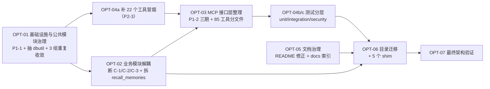

# Bionic Agent MCP — 架构优化第一阶段报告（结构梳理与低风险治理）

> 项目：`D:\Cache\Cache_Project\bionic-agent-mcp`　阶段：S0–S6 完成并提交后
> 性质：**只读分析 + 方案设计**。本轮未改任何业务代码、未移动文件、未改数据库、未提交 Git。
> 唯一的写入：`docs/ARCHITECTURE_OPTIMIZATION_PHASE1_REPORT.md`（本文件）与 `docs/ARCHITECTURE_OPTIMIZATION_TASKS.md`。

---

## 1. 当前架构概览

### 1.1 定位

**单进程、单 SQLite、无外部依赖服务**的本地 MCP 服务：Python 后端（`app/`）+ 零依赖内联前端（`app/admin_ui.html`）+ 运维 CLI（`scripts/`）+ DSH 侧边栏插件（`dsh-panel-client/`，Node）。所有状态落在一个 WAL 模式 SQLite 文件里。

### 1.2 技术栈（实测，`pyproject.toml:6-11` 与 `requirements.txt` 完全一致，无漂移）

| 依赖 | 版本约束 | 用途 |
| --- | --- | --- |
| `mcp` | `>=1.30.0,<2.0.0` | MCP 协议服务端 |
| `fastembed` | `>=0.7.3,<1.0.0` | 本地向量（`paraphrase-multilingual-MiniLM-L12-v2`，dim 384） |
| `fastapi` | `>=0.110,<1.0` | 管理面板 HTTP |
| `uvicorn[standard]` | `>=0.27,<1.0` | 面板 ASGI |
| Python | `>=3.10` | 实际 3.13.13 |

### 1.3 规模（实测）

| 维度 | 数值 |
| --- | --- |
| Python 模块总数 | **71**（AST 口径，含 tests/scripts/build_zip） |
| `app/` | **26 个 .py**，**16039 行**，约 745 KB；`admin_ui.html` 2287 行；`static/3d-force-graph.min.js` 1.39 MB |
| `tests/` | **34 个 .py**（33 套件 + 1 运行器），约 11.1 千行 |
| `scripts/` | **10 个正式 .py**（+ `dev/` 51 个未跟踪调试脚本） |
| `dsh-panel-client/` | 25 个文件（Node，8 个 lib/install + 16 个 test .mjs） |
| MCP 工具 | **85 个**（core 36 + gov 49），全在 `app/mcp_server.py` |
| Admin HTTP 路由 | **75 条**（GET 40 / POST 33 / PUT 1 / DELETE 1） |
| 数据库表 | 15 张，schema 由 `app/db.py` 幂等迁移维护 |

### 1.4 健康度总评（依据本轮实测）

| 维度 | 评价 | 依据 |
| --- | --- | --- |
| 数据安全 | **接近满分** | 三条备份路径职责互不重叠；所有裸 `sqlite3.connect` 都有 `try/finally`；**裸 `except:` 全仓 0 处**；无路径穿越、无凭据泄漏 |
| 算法纯度 | **优秀** | `app/memory_lexical.py` 与 `app/recall_profile.py` 的 `sqlite3` / `.execute(` 命中 **均为 0** |
| 测试覆盖深度 | **好** | 33 套件 / 71.2 秒全绿；备份恢复 6 套件共 3051 行、检查点 398 个 |
| 接口层边界 | **差** | **26 个 MCP 工具函体内直接写 SQL**（67 处 execute），接口层与数据层是同一层 |
| 目录职责 | **混杂** | `app/` 一个目录装 5 类东西（入口/业务/基础设施/资源/前端），**无任何子包** |
| 重复实现 | **中** | 真重复 5 组 21 份 + 3 组同名不同义 |
| 文档一致性 | **有漂移** | README 测试数字 2 处错、项目结构段只列 26 个模块中的 9 个 |
| 可观测性 | **弱** | **全仓 `import logging` 为 0 处**；`app/` 侧无结构化日志 |

---

## 2. 当前目录结构

```
bionic-agent-mcp/
├── app/                       26 个 .py + 1 html + 1 static（745 KB，★ 无任何子包）
│   ├── mcp_server.py          1738 行 ⚠ 85 个工具 + 双实例 + CLI 入口
│   ├── mcp_server_gov.py      35 行（纯转发）
│   ├── admin_ui.py            1496 行 ⚠ 75 个路由 + 启动 + 绑定守卫
│   ├── admin_ui.html          2287 行（内联 CSS+JS，零外部依赖）
│   ├── static/3d-force-graph.min.js   1.39 MB
│   ├── db.py                  911 行 ⚠ 连接/事务/只读探测/幂等迁移（唯一迁移入口）
│   ├── db_backup.py           549 行（物理备份 + 验证 + 保留策略）
│   ├── embeddings.py          164 行（FastEmbed 预热/就绪探针/降级）
│   ├── memory_lifecycle.py    1178 行 ⚠ 融合召回 + 关系 + 巩固 + 反馈 + 类型分类
│   ├── memory_lexical.py      695 行（纯词法打分 + 意图识别 + 概念桥）
│   ├── recall_profile.py      179 行（纯权重表 + clamp）
│   ├── activation_spreading.py 320 行 ／ feedback_loop.py 247 行 ／ expiry.py 240 行
│   ├── protection.py          164 行 ／ distillation.py 393 行 ／ task_resume.py 282 行
│   ├── star_map.py            366 行
│   ├── knowledge.py           1362 行 ⚠ 导入 + 分块 + 检索 + 漂移 + 重锚
│   ├── governance_service.py  1130 行 ⚠ 评分/冲突/动作/回滚/审核
│   ├── governance_maintenance.py 549 行 ／ conflicts.py 252 行 ／ scoring.py 398 行 ／ rules.py 218 行
│   ├── snapshots.py           538 行（逻辑快照 JSON dump）
│   ├── portable_backup.py     981 行 ⚠ 便携包导出/校验/清单
│   ├── portable_restore.py    1653 行 ⚠ 恢复状态机 18 状态 + 令牌 + 回滚
│   ├── __init__.py            1 行 ／ py.typed 0 字节
├── tests/                     34 个 .py（run_tests.py 186 行 + 33 套件）
├── scripts/                   10 个正式 .py（+ dev/ 51 个未跟踪）
├── dsh-panel-client/          25 个文件（Node 插件）
├── docs/                      上一轮 2 个审计 + 本轮 2 个报告
├── data/                      327 MB（其中 model_cache 252 MB）
├── logs/                      2 个 .log（未跟踪、未忽略）
├── build/ 29 文件 2.2 MB ／ dist/ 1 个 zip 680 KB ／ *.egg-info/ 6 文件（均为残留）
├── README.md 635 行 45 KB ／ pyproject.toml 34 行 ／ requirements.txt 4 行
├── build_zip.py 89 行 ／ deepseek-harness-mcp.example.yml 39 行
├── .env.example 3 行 ／ .gitignore 31 行 ／ nul 0 字节
```

**`app/` 没有任何子包** —— 26 个模块全部平铺，这是"目录职责混杂"的物理原因。

---

## 3. 核心模块职责

### 3.1 职责与分层归属（依据实际 import 与调用链判定，非文件名猜测）

| 模块 | 行数 | 层 | 实际职责（多职责标 ⚠） | 被引用 |
| --- | ---: | --- | --- | ---: |
| `mcp_server.py` | 1738 | 入口 | ①85 工具 ②`mcp`/`mcp_gov` 双实例 ③**26 个工具函体内直写 SQL** ⚠ ④`_ensure_db()` ⑤`_run_cli()` | 21 |
| `admin_ui.py` | 1496 | 入口 | ①75 路由 ②`_lifespan` ③静态文件 ④绑定守卫 ⚠ ⑤**7 个路由函体内直写 SQL** | 4 |
| `mcp_server_gov.py` | 35 | 入口 | 纯转发：`from app import mcp_server` + `_run(mcp_server.mcp_gov, "stdio")` | 1 |
| `memory_lifecycle.py` | 1178 | 业务 | ①`recall_memories`（208 行）②关系子图 ③类型分类 ④巩固 ⑤反馈 ⑥生命周期 ⚠ **6 类职责 + 39 处 SQL** | 21 |
| `memory_lexical.py` | 695 | 业务 | ①`score_all` ②意图识别 ③概念桥 ⚠ ④**反向依赖 `knowledge` 两个私有函数** | 7 |
| `knowledge.py` | 1362 | 业务 | ①文档发现 ②分块 ③导入 ④检索 ⑤漂移 ⑥路径重锚 ⑦状态报告 ⚠ **7 类职责** | 14 |
| `governance_service.py` | 1130 | 业务 | ①评分 ②冲突检测 ③裁决 ④动作/回滚 ⑤审核 ⚠ **5 类职责 + 53 处 SQL** | 5 |
| `governance_maintenance.py` | 549 | 业务 | 治理闭环：dry_run / review / apply_approved | 1 |
| `governance_conflicts.py` | 252 | 业务 | `classify_pair`（122 行） | 4 |
| `governance_scoring.py` | 398 | 业务 | 重要性/置信/时效/稳定四维打分 | 7 |
| `governance_rules.py` | 218 | 业务 | `load_rules()`（读 20 个 `BIONIC_GOV_*`） | 8 |
| `portable_restore.py` | 1653 | 业务 | ①状态机 18 态 ②令牌 ③保护性备份 ④文件+DB 恢复 ⑤回滚 ⑥验证 ⚠ **6 类 + 40 处 SQL** | 4 |
| `portable_backup.py` | 981 | 业务 | ①四模式导出 ②21 项校验 ③manifest ④清单 ⑤删除 | 7 |
| `snapshots.py` | 538 | 业务 | ①快照 dump ②恢复 ③清理 ⚠ ④**自建 `db_snapshots` 表** | 7 |
| `db_backup.py` | 549 | 基础设施 | ①`Connection.backup` ②验证 ③保留策略 ④只读 URI | 3 |
| `distillation.py` | 393 | 业务 | 簇发现 → 候选 → 应用 | 3 |
| `star_map.py` | 366 | 业务 | 星图布局（`build_graph` 192 行） | 1 |
| `activation_spreading.py` | 320 | 业务 | 激活扩散（纯读） | 3 |
| `task_resume.py` | 282 | 业务 | 任务快照/续跑包/卡住检测 | 3 |
| `feedback_loop.py` | 247 | 业务 | 反馈闭环（retrieved 不计分、±25% 上限） | 6 |
| `expiry.py` | 240 | 业务 | 有效期扫描/降权 | 4 |
| `protection.py` | 164 | 业务 | 四档保护判定 | 6 |
| `recall_profile.py` | 179 | 业务 | 召回画像权重表 + clamp | 4 |
| `embeddings.py` | 164 | 基础设施 | FastEmbed 加载/预热/降级 | 17 |
| `db.py` | 911 | 基础设施 | ①连接/事务 ②只读探测 ③`init_db` 四分支 ④**唯一迁移入口** | 49 |

### 3.2 职责混杂清单（实测）

| # | 混杂点 | 证据 |
| ---: | --- | --- |
| 1 | **接口层与数据访问层同一层** | `mcp_server.py` 26 个工具函体内共 67 处 `.execute(`；`admin_ui.py` 7 个路由内共 12 处 |
| 2 | **入口层直连数据库** | `admin_ui.api_stats` L1322-1327 连发 6 条 SQL；`supersede_memory` L355-368 6 条、`handoff_task` L529-536 6 条 |
| 3 | **schema DDL 分散两处** | `db.py` 是唯一迁移入口，但 `snapshots.py:91` 自建 `CREATE TABLE IF NOT EXISTS db_snapshots` |
| 4 | **算法层反向依赖知识库私有函数** | `memory_lexical.py:35 from app.knowledge import _SYNONYM_GROUPS, _segments` |
| 5 | **业务层反向依赖入口层** | `memory_lifecycle.py:809 from app import mcp_server as _mcp` |
| 6 | **正式脚本与评测脚本同目录** | `eval_lexical.py`/`eval_local.py`/`eval_recall.py` 与运维脚本并列，靠 `build_zip.py:44` 的 `name.startswith("eval_")` 排除发布 |
| 7 | **调试脚本与正式代码同仓** | `scripts/dev/` 51 个未跟踪脚本（约 208 KB） |
| 8 | **前端资源与后端代码同目录** | `admin_ui.html` 2287 行与 `app/*.py` 并列；`static/` 是唯一子目录 |
| 9 | **入口文件职责过重** | `mcp_server.py` = 工具定义 + 双实例 + CLI 入口 + DB 初始化钩子，1738 行 / 95 个函数 |

---

## 4. 依赖关系图（Mermaid）

### 4.1 五层视图（88 条 app 内部边全量统计后的聚合）

```mermaid
graph TD
    subgraph L1["① 入口层 Entry"]
        MS["mcp_server.py<br/>1738 行 / 85 工具"]
        MSG["mcp_server_gov.py<br/>35 行"]
        AUI["admin_ui.py<br/>1496 行 / 75 路由"]
        SCR["scripts/*.py<br/>10 个 CLI"]
    end
    subgraph L2["② 接口层 Interface（★ 当前 0 个模块）"]
        GAP["MCP Tool 定义 / HTTP Handler<br/>物理上写在 L1 文件内"]
    end
    subgraph L3["③ 业务服务层 Services"]
        ML["memory_lifecycle"]  MLEX["memory_lexical"]  RP["recall_profile"]
        ACT["activation_spreading"]  FB["feedback_loop"]  EXP["expiry"]
        PRT["protection"]  DIST["distillation"]  TR["task_resume"]  SM["star_map"]
        KN["knowledge"]  GS["governance_service"]  GM["governance_maintenance"]
        GC["governance_conflicts"]  GSC["governance_scoring"]  GR["governance_rules"]
        SNAP["snapshots"]  PB["portable_backup"]  PR["portable_restore"]
    end
    subgraph L4["④ 基础设施层 Infrastructure"]
        DB["db.py<br/>连接/事务/迁移/探测"]
        DBB["db_backup"]  EMB["embeddings"]
    end
    subgraph L5["⑤ 数据层 Data"]
        SQLITE[("SQLite WAL<br/>data/agent.db")]
        FILES[("snapshots/*.json<br/>backups/*.db<br/>memory_packages/*.zip")]
        VEC[("memory_embeddings<br/>knowledge_embeddings")]
    end

    MS --> GAP
    AUI --> GAP
    MSG --> MS
    SCR --> MS

    MS --> ML & MLEX & KN & GS & GM & GC & GSC & GR & SNAP & PB & PR & DIST & TR & EXP & FB & PRT & ACT
    AUI --> ML & GS
    GS --> GC & GSC & GR & FB & EMB
    ML --> MLEX & RP & ACT & FB & EXP & PRT & GC & GSC & GR & GS & SNAP & EMB
    MLEX --> KN
    KN --> EMB
    GM --> GC & GSC & GR & GS
    GSC --> GR & FB & PRT
    PB --> SNAP & KN & EMB
    PR --> PB & SNAP & KN
    SNAP --> GM
    PRT --> GR
    ACT --> GSC & GR

    ML & MLEX & KN & GS & SNAP & PB & PR & DBB & EMB --> DB
    DB --> SQLITE
    DBB --> FILES
    PB & PR --> FILES
    KN & ML & EMB --> VEC
```

### 4.2 关键依赖事实（逐条实测）

| 事实 | 证据 |
| --- | --- |
| **app 内部边共 88 条**，涉及 26 个模块 | AST 全量扫描（`from app import x` 与 `from app.x import y` 两种写法都归一） |
| **`db.py` 被 49 个模块引用、74 个 import 站点** | 唯一的超级 fan-in |
| `memory_lifecycle` 21 模块 / 31 站点；`embeddings` 17 / 24；`mcp_server` 21 / 22；`knowledge` 14 / 15 | 见 `edges.json` |
| **循环依赖：1 个 SCC（4 元）** | Tarjan：`distillation ↔ mcp_server ↔ memory_lifecycle ↔ recall_profile` |
| 该 SCC **实际不可死锁** | `recall_profile→memory_lifecycle` 与 `memory_lifecycle→mcp_server` 都是**函数内延迟 import**；两种导入顺序实测都成功 |
| **入口层直连数据库** | `mcp_server.py` 67 处、`admin_ui.py` 12 处（函数体内 `.execute(` 计数） |
| **接口层为 0 个模块** | 85 工具与 75 路由全部物理写在入口层文件内 |
| 业务模块互调的复杂链路 | `mcp_server → governance_maintenance → governance_service → conflicts/scoring → rules`（5 跳）；`portable_restore → portable_backup → snapshots → governance_maintenance`（4 跳，且 snapshots 反向依赖治理维护） |

### 4.3 依赖方向不合理清单

| # | 方向 | 说明 |
| ---: | --- | --- |
| 1 | 业务层 → 入口层 | `memory_lifecycle.py:809 from app import mcp_server as _mcp`（方向倒置） |
| 2 | 算法层 → 知识库层（私有） | `memory_lexical.py:35` 借 `knowledge` 的 `_SYNONYM_GROUPS` 与 `_segments`（下划线私有） |
| 3 | 备份层 → 治理层 | `snapshots.py` → `governance_maintenance.py`（快照本该只碰 db，现在会拉起整个治理链） |
| 4 | 入口层 → 数据层（直连） | 26 个 MCP 工具 + 7 个 HTTP 路由函体内直接 `.execute(`，跳过任何数据访问层 |

**无问题的部分（明确记录，防过度改造）**：`app/db.py` 只依赖标准库，零 app 内依赖 —— 分层的基石是干净的。

---

## 5. 模块复杂度排名与 A/B/C/D 分级

### 5.1 复杂度指标（全量实测，`app/` 26 个模块）

| 排名 | 模块 | 行数 | 公开函数 | 最长函数 | 导入 | fan-in | fan-out | SQL | 工具 |
| ---: | --- | ---: | ---: | --- | ---: | ---: | ---: | ---: | ---: |
| 1 | `mcp_server.py` | 1738 | **85** | `save_memory` 68 | 29 | 2 | 5 | **67** | **85** |
| 2 | `portable_restore.py` | 1653 | 9 | `preview_restore` **231** | 20 | 0 | 4 | 40 | 0 |
| 3 | `admin_ui.py` | 1496 | **77** | `api_memories_timeline` 83 | 39 | 0 | 3 | 12 | 0 |
| 4 | `knowledge.py` | 1362 | 11 | `_keyword_scores` 145 | 11 | 6 | 2 | 33 | 0 |
| 5 | `memory_lifecycle.py` | 1178 | 14 | `recall_memories` **208** | 23 | 6 | 2 | 39 | 0 |
| 6 | `governance_service.py` | 1130 | 17 | `rollback_governance_action` 113 | 9 | 1 | 4 | 53 | 0 |
| 7 | `portable_backup.py` | 981 | 8 | `validate_package_archive` **207** | 16 | 1 | 4 | 6 | 0 |
| 8 | `db.py` | 911 | 7 | `probe_database_state` 135 | 6 | **9** | 0 | 56 | 0 |
| 9 | `memory_lexical.py` | 695 | 10 | `score_all` 91 | 3 | 0 | 1 | **0** | 0 |
| 10 | `db_backup.py` | 549 | 7 | `create_physical_backup` 179 | 10 | 0 | 1 | 6 | 0 |
| 11 | `governance_maintenance.py` | 549 | 6 | `_build_plan` 96 | 12 | 1 | 5 | 17 | 0 |
| 12 | `snapshots.py` | 538 | 5 | — | 8 | 2 | 2 | 19 | 0 |
| 13 | `governance_scoring.py` | 398 | 9 | — | 7 | 5 | 2 | **0** | 0 |
| 14 | `distillation.py` | 393 | 3 | — | 5 | 0 | 3 | 10 | 0 |
| 15 | `star_map.py` | 366 | 1 | `build_graph` **192** | 5 | 0 | 1 | 3 | 0 |
| 16 | `activation_spreading.py` | 320 | 7 | — | 9 | 0 | 2 | 5 | 0 |
| 17 | `task_resume.py` | 282 | 5 | — | 4 | 0 | 1 | 12 | 0 |
| 18 | `governance_conflicts.py` | 252 | 7 | `classify_pair` 122 | 3 | 3 | 0 | **0** | 0 |
| 19 | `feedback_loop.py` | 247 | 7 | — | 6 | 0 | 1 | 4 | 0 |
| 20 | `expiry.py` | 240 | 5 | — | 5 | 0 | 1 | 4 | 0 |
| 21 | `governance_rules.py` | 218 | 1 | — | 3 | 6 | 0 | **0** | 0 |
| 22 | `recall_profile.py` | 179 | 3 | — | 2 | 0 | 1 | **0** | 0 |
| 23 | `embeddings.py` | 164 | 7 | — | 5 | 7 | 0 | 0 | 0 |
| 24 | `protection.py` | 164 | 4 | — | 1 | 0 | 1 | **0** | 0 |
| 25 | `mcp_server_gov.py` | 35 | 0 | — | 3 | 1 | 1 | 0 | 0 |
| 26 | `__init__.py` | 1 | 0 | — | 0 | 0 | 0 | 0 | 0 |

**类型提示覆盖率（改动风险的直接指标）**：`db.py` **0.71**（最低）、`admin_ui.py` 0.78、`governance_maintenance.py` 0.85、`memory_lifecycle.py` 0.93、`portable_restore.py` 0.94，其余 15 个模块 **1.00**。→ **`db.py` 与 `admin_ui.py` 是"改起来最容易漏"的两个文件**。

### 5.2 A/B/C/D 分级（依据：行数、职责数、fan-in、SQL 密度、改动风险）

#### A 级 —— 无需调整（10 个）

| 模块 | 行数 | 理由 |
| --- | ---: | --- |
| `protection.py` | 164 | 单一职责（四档判定），0 SQL，28 项测试全覆盖 |
| `recall_profile.py` | 179 | 纯权重表 + clamp，0 SQL，62 项测试 |
| `governance_rules.py` | 218 | 纯阈值表，0 SQL，被 6 模块依赖但只读 |
| `expiry.py` | 240 | 单一职责，37 项测试 |
| `feedback_loop.py` | 247 | 单一职责，26 项测试 |
| `governance_conflicts.py` | 252 | 纯分类函数，0 SQL |
| `task_resume.py` | 282 | 单一职责，42 项测试 |
| `embeddings.py` | 164 | 基础设施薄封装，接口稳定 |
| `mcp_server_gov.py` | 35 | 纯转发，无可拆内容 |
| `__init__.py` | 1 | 空 |

#### B 级 —— 建议优化（5 个，低风险）

| 模块 | 行数 | 建议 |
| --- | ---: | --- |
| `activation_spreading.py` | 320 | 7 个公开函数可收成 2-3 个入口；纯读无副作用 |
| `star_map.py` | 366 | `build_graph` 单函数 192 行，可拆布局/聚类/裁剪三段 |
| `distillation.py` | 393 | 3 个公开函数 + 8 处 `except Exception`，可拆"候选"与"应用" |
| `governance_scoring.py` | 398 | 0 SQL 纯算法，四维打分可各自成函数；低优先 |
| `governance_maintenance.py` | 549 | 5 个 fan-out，`_build_plan` 96 行可拆 |

#### C 级 —— 重点优化（7 个，中等风险）

| 模块 | 行数 | 建议 | 风险点 |
| --- | ---: | --- | --- |
| `db.py` | 911 | 拆 `connection.py` + `schema.py`（DDL/迁移/探测） | **D 级边界**：签名变化影响 49 模块；只允许"移动不改签名" |
| `snapshots.py` | 538 | 把 `db_snapshots` DDL 移回 `db.py` | 需确认迁移顺序 |
| `portable_backup.py` | 981 | 拆导出 / 校验 / 清单 | `validate_package_archive` 207 行 |
| `knowledge.py` | 1362 | 拆"导入管道"（discover/import/embed/prune/reanchor）与"检索"（search/get_doc/get_chunk/status/drift） | 33 处 SQL；检索侧直接影响 38 题基准 |
| `memory_lexical.py` | 695 | 只断开对 `knowledge` 私有函数的依赖 | **算法本体不动**（α / 短语表 / seed 阈值都是红线） |
| `governance_service.py` | 1130 | 拆 评分 / 冲突 / 动作回滚 / 审核 四段 | 53 处 SQL，影响治理工具 49 个 |
| `portable_restore.py` | 1653 | 拆 状态机 / 令牌 / 文件恢复 / DB 恢复 / 回滚 / 验证 | 恢复语义是红线，只能搬不改逻辑 |

#### D 级 —— 高风险核心模块（4 个，**本轮只出方案，未经评审不得重构**）

| 模块 | 行数 | 为什么是 D |
| --- | ---: | --- |
| `db.py` | 911 | **唯一迁移入口**。`init_db()` 四分支 + 只读探测 + `probe_database_state` 的 immutable 双模式都有反证实验支撑；49 模块依赖它。任何逻辑改动都可能"启动即迁移"或"误判库完整" |
| `mcp_server.py` | 1738 | **85 个工具的唯一物理载体**。工具名/参数/返回是外部契约，改一个字就断宿主 |
| `memory_lifecycle.py` | 1178 | **融合召回的单一实现**。`RECALL_WEIGHTS` / seed 门 / 概念桥 / 意图抑制 / activation 二阶效应相互咬合；六套评测（45/24/48/38/NL/PURE）逐位一致是硬门槛 |
| `portable_restore.py` | 1653 | **恢复状态机**：18 状态 + 一次性令牌 TTL 300s + 保护性备份 + 自动回滚。改错的后果是"恢复失败且不可回滚" |

---

## 6. 文件复杂度排名（含跨层实证）

### 6.1 SQL 密度排行（说明"谁真正在碰数据库"）

| 排名 | 文件 | execute | 层 |
| ---: | --- | ---: | --- |
| 1 | `mcp_server.py` | **67** | 入口层 ⚠ |
| 2 | `db.py` | 56 | 基础设施 ✅ 合理 |
| 3 | `governance_service.py` | 53 | 业务 ⚠ 偏多 |
| 4 | `portable_restore.py` | 40 | 业务 ⚠ 偏多 |
| 5 | `memory_lifecycle.py` | 39 | 业务 ⚠ 偏多 |
| 6 | `knowledge.py` | 33 | 业务 |
| 7 | `snapshots.py` | 19 | 业务 |
| 8 | `governance_maintenance.py` | 17 | 业务 |
| 9 | `admin_ui.py` | **12** | 入口层 ⚠ |
| 10 | `task_resume.py` | 12 | 业务 |
| 11 | `distillation.py` | 10 | 业务 |
| 12 | `portable_backup.py` / `db_backup.py` | 6 / 6 | 备份 ✅ |
| 13 | `activation_spreading.py` | 5 | 业务 |
| 14 | `feedback_loop.py` / `expiry.py` | 4 / 4 | 业务 |
| 15 | `star_map.py` | 3 | 业务 |
| — | `memory_lexical` / `recall_profile` / `governance_rules` / `governance_scoring` / `governance_conflicts` / `protection` / `embeddings` | **0** | ✅ 纯函数 |

### 6.2 单函数超长清单

| 函数 | 文件 | 行数 |
| --- | --- | ---: |
| `preview_restore` | `portable_restore.py` | **231** |
| `recall_memories` | `memory_lifecycle.py` | **208** |
| `validate_package_archive` | `portable_backup.py` | **207** |
| `build_graph` | `star_map.py` | **192** |
| `create_physical_backup` | `db_backup.py` | 179 |
| `_keyword_scores` | `knowledge.py` | 145 |
| `probe_database_state` | `db.py` | 135 |
| `classify_pair` | `governance_conflicts.py` | 122 |
| `rollback_governance_action` | `governance_service.py` | 113 |
| `_build_plan` | `governance_maintenance.py` | 96 |
| `score_all` | `memory_lexical.py` | 91 |
| `api_memories_timeline` | `admin_ui.py` | 83 |

> **判读纪律：超长 ≠ 该拆。** `recall_memories`(208)、`probe_database_state`(135)、`create_physical_backup`(179) 的超长是"顺序步骤多、每步都有不可省略的边界检查"，硬拆会把一条原子流程切碎、增加出错面。真正值得拆的是 `build_graph`（布局/聚类/裁剪三段天然独立）与 `api_memories_timeline`（分档统计可提为纯函数）。

---

## 7. 模块耦合问题

### 7.1 耦合热点（实测）

| 模块 | fan-in | fan-out | 判读 |
| --- | ---: | ---: | --- |
| `db.py` | **49 模块 / 74 站点** | **0** | 合理的"基础设施被所有人依赖"；但同担 DDL/迁移/探测/事务四件事，是**扇入过大 + 职责过宽**叠加 |
| `memory_lifecycle.py` | 21 / 31 | 13 | 双向重耦合：既被广泛调用，又依赖 13 个模块（含反向依赖 `mcp_server`） |
| `mcp_server.py` | 21 / 22 | 17 | 入口层承担 17 个业务依赖，**无应用服务层缓冲** |
| `embeddings.py` | 17 / 24 | 0 | 叶子节点，健康 |
| `knowledge.py` | 14 / 15 | 2 | 被 14 模块依赖，其中一个是算法层反向依赖 |
| `governance_rules.py` | 8 / 6 | 0 | 纯阈值表，健康 |
| `admin_ui.py` | 4 | **15** | 入口层直接依赖 15 个业务模块，无中间层 |
| `portable_restore.py` | 4 | 4 | 依赖 `portable_backup` + `snapshots` + `knowledge` + `db` |
| `portable_backup.py` | 7 | 4 | 同上 |
| `snapshots.py` | 7 | 2 | **其中一个依赖是 `governance_maintenance`**（异常方向） |

### 7.2 循环依赖（1 个 4 元 SCC，已逐边验证不可死锁）

| 边 | 模块级？ | 结论 |
| --- | --- | --- |
| `distillation → memory_lifecycle` | ✅ 模块级（`:35`） | 真实耦合 |
| `memory_lifecycle → recall_profile` | ✅ 模块级（`:28`） | 真实耦合 |
| `recall_profile → memory_lifecycle` | ❌ 函数内延迟（`:133`） | **环的唯一"断点"，靠它才没死锁** |
| `memory_lifecycle → mcp_server` | ❌ 函数内延迟（`:809`，注释自述 `# local import to avoid cycle at module load`） | 断点 |
| `mcp_server → memory_lifecycle` | ✅ 模块级 + 延迟各一处 | 真实耦合 |
| `mcp_server → distillation` | ✅ 模块级 | 真实耦合 |

**实测验证**：两种 import 顺序**都能成功**，运行时无死锁。

**判读**：这个 SCC 不是"运行故障"，而是**结构信号** —— `recall_profile` 与 `memory_lifecycle`、`mcp_server` 与 `memory_lifecycle` 之间存在双向概念耦合。`recall_profile.py:130-131` 的 docstring 自述：

> `base` is the caller's default table so this module never has to import memory_lifecycle (which would be a circular import).

即**作者已知这个环并用延迟导入绕开**，但绕法没被固化成结构（没有纯接口模块）。

### 7.3 耦合问题清单

| # | 问题 | 位置 | 影响 |
| --- | --- | --- | --- |
| C-1 | 业务层依赖入口层 | `memory_lifecycle.py:809` | 让 `memory_lifecycle` 无法在无 MCP 环境复用（如纯 CLI） |
| C-2 | 算法层依赖知识库私有函数 | `memory_lexical.py:35` | `knowledge` 内部重命名会静默打断词法检索 |
| C-3 | 备份层依赖治理层 | `snapshots.py → governance_maintenance.py` | 拍快照会拉起治理链，扩大失败面 |
| C-4 | 入口层直连数据层 | 26 工具 + 7 路由 | 无数据访问抽象，SQL 与协议代码混写 |
| C-5 | 4 元循环（靠延迟导入断开） | 见 §7.2 | 结构脆弱：任何人"顺手"把延迟 import 移到顶部就引入真死锁 |
| C-6 | 无接口层 | `app/` 无子包 | 85 工具与 75 路由无法按域拆分，只能继续堆在入口文件 |

---

## 8. 重复代码分析

### 8.1 顶层函数重复（app/ 内 2 处及以上，共 9 组）

| 函数 | 份数 | 判定 | 证据 |
| --- | ---: | --- | --- |
| `_now` | **8** | **3 种语义 + 4 种格式，不可合并，只能显式命名** | 见 §8.2 |
| `_parse_ts` | **5** | **5 份实现互不相同，不可合并** | 相似度：`admin_ui` vs `governance_service` 仅 **0.08**；最高一对（`expiry` vs `task_resume`）也只有 **0.59** |
| `_readonly_uri` | 2 | **可抽取**（相似度 0.63，差异仅 `immutable` 可选参数） | `db_backup.py:139`（无 immutable）vs `portable_backup.py:205`（`immutable: bool = False`） |
| `_immutable_uri` | 1（等价于 `_readonly_uri(immutable=True)`） | **可合并进同一实现** | `db_backup.py:152` |
| `_sidecar_snapshot` | 2 | **可抽取**（相似度 **0.97**，逐行同构） | `db.py:200` vs `portable_backup.py:178` |
| `_wal_has_content` | 2 | **可抽取**（相似度 **0.97**，逐行同构） | `db.py:185` vs `portable_backup.py:190` |
| `_json` | 2 | **同名不同义 → 只改名** | `governance_service.py:74`（异常回 `"{}"`）vs `memory_lifecycle.py:124`（`None`/`""`→default） |
| `_event` | 2 | **同名不同义 → 只改名** | `governance_service.py:91`（复用调用方 conn，事务内）vs `mcp_server.py:71`（自开 `with connect()`） |
| `_run` | 2 | **同名不同义 → 只改名** | `admin_ui.py:178`（HTTP `{"ok":False}`→404/400）vs `mcp_server.py:1725`（`_ensure_db()` + `server.run`） |
| `_run_cli` | 3 | **合法**：`pyproject.toml` 三个 console entry 各自需要 | `admin_ui.py:1470`、`mcp_server.py:1730`、`mcp_server_gov.py:29` |

### 8.2 `_now` 为什么不能合并（本轮最重要的"不作为"依据）

8 份实现的**返回类型与字符串格式都不同**，实测输出：

| 文件 | 返回 | 格式 |
| --- | --- | --- |
| `distillation.py:48` / `snapshots.py:78` | `str` | `2026-11-20T21:51:35+08:00`（带时区） |
| `portable_restore.py:78` | `str` | 同上，但用 `datetime.now()` |
| `memory_lifecycle.py:119` | `str` | **`2026-11-20 13:51:35`**（空格分隔、无时区、UTC） |
| `expiry.py:54` / `governance_scoring.py:63` / `star_map.py:37` / `task_resume.py:43` | **`datetime`** | 不是字符串 |

调用点语义也不同：`expiry.py` 要做 `_now() + timedelta(days=days)`（必须 `datetime`）；`memory_lifecycle.py` 直接写进 SQL 的 `TEXT` 列（必须 `str`）；`task_resume.py` 要做 `(_now() - ts).total_seconds()`（必须 `datetime`）。

**结论**：合并会同时改变 ①库内已存时间戳格式（历史数据与新数据形态不一致，`_parse_ts` 的 5 份实现各认各的）②8 个模块的返回类型。**这是"看似重复、实为不同契约"的典型，列为不动项。**

### 8.3 公共基础设施现状（15 类检查项实测）

| 类别 | 总量 | 分布(app/tests/scripts) | 抽取建议 | 风险 |
| --- | ---: | --- | --- | --- |
| SQLite 连接与事务 | 79 处 | 4 / 9 / 3 文件 | **部分**：`portable_restore.py:1061 _connect_at` / `:1079 _transaction_at` 与 `db.py:442 connect` / `:469 transaction` 逐行重复，可参数化收敛 | 中（事务边界） |
| Readonly URI | 35 处，4 处独立构造 | app 4 文件 | **是**：提 `dbutil.readonly_uri(path, *, immutable=False)`，8 个未编码点一并修 | **低**（且顺带修真实缺陷） |
| DB 初始化/迁移 | 106 处 | 4 / 26 / 2 | **否**：`db.py` 已是唯一入口，别再造第二套 | — |
| JSON 处理 | 138 处 | 14 / 12 / 11 | **否**：标准库，包一层无收益 | — |
| 文件安全校验 | 21 处 | app 5 文件 | **否**：`portable_backup._safe_rel` / `_is_sensitive` 已集中 | — |
| SHA256 | 28 处 | 6 / 5 / 1 | **部分**：`sha256_file` 只在 `db_backup.py:165` 定义一次，其余是业务内联（如 `snapshots.py` 算 payload 哈希），语义不同 | 低 |
| 原子写入/替换 | 48 处 | 3 / 29 / 1 | **否**：`os.replace` + `tempfile` 已够简单 | — |
| 临时文件处理 | 84 处 | 3 / 29 / 1 | **否**：主要是 tests 用 | — |
| 路径验证 | 21 处 | app 5 | **否**：分散但各有关键判据（`resolve(strict=True).parent` 等） | — |
| 备份校验 | 82 处 | 6 / 6 / 1 | **否**：三条路径校验语义不同（21 项 / 4 项 / 快照 rule_version），强行统一会掩盖差异 | 高 |
| 日志 | **0 处 `import logging`** | 0 / 0 / 0 | **是（新增而非抽取）**：`app/` 侧全靠 `print`（`app/` 仅 1 处） | 低 |
| 错误处理 | `except Exception` 136 处；裸 `except:` **0** | 17 / 8 / 6 | **部分**：`portable_restore.py` 23 处、`portable_backup.py` 12 处可归纳为"备份域统一失败签名" | 中 |
| MCP 参数校验 | 41 处 | 3 / 1 / 0 | **部分**：`_tool_result`/`_tool_error` 已存在，但 85 工具里 66 个直接返回 dict 字面量，20 个用 `_tool_*` | 中 |
| 配置读取 | 34 处，**30 个不同环境变量** | 3 / 19 / 1 | **是**：无统一清单（见 §8.4） | 低 |
| Embedding 调用 | 89 处 | 6 / 4 / 6 | **否**：`embeddings.py` 已是唯一实现 | — |

### 8.4 环境变量清单（实测 30 个，散落在 3 个文件里）

| 变量 | 定义处 | 用途 |
| --- | --- | --- |
| `BIONIC_DB_PATH` | `db.py:12`（`db_backup.py:81`、`import_dsh_memory.py:30` 复用） | 库路径，测试隔离的关键 |
| `BIONIC_DB_BUSY_TIMEOUT` | `db.py:20` | 锁等待秒数（默认 30） |
| `BIONIC_EMBEDDING_MODEL` / `BIONIC_EMBEDDING_CACHE` | `embeddings.py:8` / `:15,:17` | 模型名与缓存目录 |
| `BIONIC_PACKAGE_DIR` | `portable_backup.py:14` | 备份包受管目录 |
| `BIONIC_SNAPSHOT_DIR` | `snapshots.py:62` | 逻辑快照目录 |
| `BIONIC_GOVERNANCE_RULE_VERSION` / `BIONIC_GOVERNANCE_CANDIDATES` | `governance_rules.py:15` / `:66,:190` | 治理规则版本与候选上限 |
| `BIONIC_GOV_*`（**17 个**） | `governance_rules.py:166-198` | 评分权重/阈值/归档条件，逐个 `os.environ.get` 内联 |
| `DSH_MEMORY_ROOT` | `knowledge.py:49`（默认 `C:\Users\xing\.dsh\dsh-memory`） | 权威源根目录 |

**问题**：没有任何一处集中声明，README 未列出任何一个，`.env.example` 只有 3 行。

---

## 9. 测试体系评估

### 9.1 实际执行结果（本轮真跑，非引用历史）

```
python tests/run_tests.py  →  exit=0  /  33 项全 PASS  /  71.2 秒  /  stderr 0 字节
```

| 分项 | 数量 |
| --- | ---: |
| 测试套件 | 33 |
| 运行器 | 1（`run_tests.py`，另有 `run_tests_optimize_test.py` 作为它的回归测试） |
| 检查点（`check(...)` 或裸 `assert`）总计 | 约 1180 个 |

### 9.2 分布（按关注点分类，依据文件名与所 import 的模块）

| 类别 | 套件数 | 行数 | 检查点 | 最长套件 |
| --- | ---: | ---: | ---: | --- |
| 备份与恢复 | 6 | **3051** | 398 | `portable_restore_test.py` 747 行 |
| 检索与评分 | 7 | 1913 | 225 | `concept_bridge_diag_test.py` 314 行 |
| 记忆治理 | 7 | 1523 | 207 | `distillation_test.py` 275 行 |
| 数据库与迁移 | 3 | 1297 | 130 | `init_db_probe_test.py` 797 行 |
| 管理面板 | 3 | 932 | 147 | `admin_backup_restore_test.py` 535 行 |
| 任务与时间线 | 2 | 342 | 53 | `task_resume_test.py` 210 行 |
| 导入与嵌入 | 2 | 312 | 35 | `import_dsh_memory_test.py` 279 行 |
| MCP 接口 | 2 | 133 | 10 | `verify_mcp_split_test.py` 101 行 |
| 测试运行器 | 1 | 190 | 14 | — |

### 9.3 分层判读

| 层次 | 现状 | 说明 |
| --- | --- | --- |
| 单元测试 | **有，但不是独立文件组织** | 纯函数型（`concept_bridge_test` / `recall_profile_test` / `lexical_test`）本质是单元测试，但与集成测试同目录同命名 |
| 集成测试 | **主体** | 34 个里至少 20 个要建真库、跑真 MCP 对象 |
| 安全测试 | 有，混在功能套件里 | `admin_host_guard_test`(64 项)、`concept_bridge_diag_test` 的 E 组（生产库未触碰）、`admin_backup_restore_test` 的令牌分支 |
| 数据库测试 | 有 | `init_db_probe_test` 94 项、`db_backup_test` 104 项 |
| 回归测试 | 有 | `run_tests_optimize_test`（抗 `PYTHONOPTIMIZE`）、`snapshot_test` 的 FK 回滚 |

**问题**：34 个套件全在同一目录，**没有 `unit/` 与 `integration/` 的物理分层**，导致跑单元级改动也必须等 71 秒全量。

### 9.4 数据隔离现状（实测）

| 隔离方式 | 套件数 | 说明 |
| --- | ---: | --- |
| 设 `BIONIC_DB_PATH` 环境变量 | 21 | 主流做法，最干净 |
| 改 `db.DB_PATH` 全局变量 | 14 | 有效但有全局污染风险 |
| `Connection.backup()` 复制到临时库 | 1 | 仅 `portable_backup_metadata_test` |
| 只读 URI | 2 | 用于指纹核对 |

**"读生产库"核查（重要，避免误判）**：静态扫描曾命中 6 个文件出现 `data/agent.db` 字样，逐个核实后：

| 文件 | 实际上是什么 |
| --- | --- |
| `lexical_test.py:93` | **真读**：`sqlite3.connect(... / "data" / "agent.db")` 取 `status='active'` 标题造动态用例 |
| `concept_bridge_diag_test.py:27` | 只做**文件指纹**（size / mtime_ns），`:292-293` 断言 `-wal`/`-shm` 不存在 |
| `init_db_probe_test.py:750` | 只做**文件指纹**（`stat().st_size`、`st_mtime_ns`） |
| `portable_backup_metadata_test.py:119` | `production_fp()` 注释明写「只用文件 API，不连接数据库」 |
| `db_backup_test.py` | 全是 `tmp/...` 临时路径 |
| `admin_backup_restore_test.py` | 全是 mock 数据里的字符串常量 |

→ **真正"依赖生产库内容"的只有 1 个：`lexical_test.py`**。它的标题自召回基准（`recall@1 47/48`）随生产库条数变化，这是已知设计取舍。

### 9.5 裸 `assert`（可被 `-O` / `PYTHONOPTIMIZE` 剥离）的 4 个套件

`embedding_test.py`、`recall_profile_test.py`、`smoke_test.py`、`run_tests_optimize_test.py`。

其中 `run_tests_optimize_test.py` 是**故意的**（它的职责就是验证这件事），另 3 个由 `run_tests.py:82 env["PYTHONOPTIMIZE"] = ""` 兜住。**本轮真跑验证**：`PYTHONOPTIMIZE=1` 外部环境 + 统一入口 → 33/33 仍全 PASS，防护有效。

### 9.6 运行器评估

| 项 | 实测 |
| --- | --- |
| 发现机制 | `sorted(TESTS.glob("*_test.py"))` → 33 个，与磁盘一致，无遗漏 |
| 子进程创建 | `subprocess.run(..., creationflags=CREATE_NEW_PROCESS_GROUP)`（脱离父控制台进程组） |
| 超时 | 每项 600s，超时判失败 |
| 失败判定 | `proc.returncode == 0` |
| 静默跳过 | **无**（无 SKIP 分支、无 `IN_PROCESS` 绕法） |
| `--only` 拼错 | **rc=2** + 打印可用清单 |
| 环境清理 | `PYTHONOPTIMIZE=""`、`PYTHONIOENCODING=utf-8`、`PYTHONPATH=ROOT` |
| 总耗时 | **71.2 秒**（最慢 `portable_restore_test` 13.3s、`concurrency_test` 8.8s） |

**评估：运行器健康，无"把失败改通过"的机制。** 唯一可改进点是没有分层开关。

---

## 10. 文档治理建议

### 10.1 现状盘点

| 文档 | 位置 | 状态 |
| --- | --- | --- |
| 项目说明 | `README.md` 635 行 / 45 KB | 主文档，但项目结构段严重滞后 |
| 架构审计 | `docs/ARCHITECTURE_AUDIT_S0_S6.md` 1377 行 | 上一轮产出，准确 |
| 文件清单 | `docs/ARCHITECTURE_FILE_INVENTORY.csv` 149 行 | 上一轮产出，准确 |
| 架构优化报告 | `docs/ARCHITECTURE_OPTIMIZATION_PHASE1_REPORT.md` | 本轮 |
| 任务清单 | `docs/ARCHITECTURE_OPTIMIZATION_TASKS.md` | 本轮 |
| MCP 配置示例 | `deepseek-harness-mcp.example.yml` 39 行 | 已同步（36/49） |
| 环境变量说明 | `.env.example` **3 行** | **几乎为空**（实际 30 个变量） |
| MCP 工具文档 | **不存在** | 85 个工具说明只存在于 docstring |

### 10.2 实测到的文档与代码不一致（4 处，全部有行号）

| # | 位置 | 文档写的 | 实际 | 严重度 |
| --- | --- | --- | --- | --- |
| D-1 | `README.md:584` | `snapshot_test`「31 项」 | **57 项** | P3 |
| D-2 | `README.md:586` | `distillation_test`「37 项」 | **39 项** | P3 |
| D-3 | `README.md:356-375` 项目结构段 | 只列 9 个 `app/` 条目 | `app/` 有 **26 个 .py**；**13 个模块完全未出现**：`db_backup` / `memory_lexical` / `portable_backup` / `portable_restore` / `snapshots` / `knowledge` / `recall_profile` / `protection` / `expiry` / `star_map` / `task_resume` / `feedback_loop` / `distillation` | **P2**（新人照 README 完全找不到物理备份与便携包在哪） |
| D-4 | `README.md` 全文 | `docs/` **提及 0 次** | 已有 4 个架构文档 | P3 |

### 10.3 其他文档问题

| 问题 | 证据 |
| --- | --- |
| **README 过长且单文件承载 9 类内容** | 635 行里混了：功能总览、环境要求、快速开始、面板用法、项目结构、记忆模型、9 条设计决定、可移植要点、测试、已知限制 |
| 无统一文档入口 | `docs/` 无 `README.md`，四份文件之间没有索引 |
| 85 个工具无外部文档 | docstring 平均约 60 字符，**58 个 < 40 字符**（最短 `list_tasks`/`get_task` 各 10 字符） |
| 无架构图 | 上一轮审计才有第一张依赖图（在 `docs/` 里，README 未引用） |

### 10.4 建议的 `docs/` 结构（仅建议，本轮未重组任何文档）

```
docs/
├── README.md                    ← 新增：文档索引（指向下面所有文件）
├── architecture/
│   ├── overview.md              ← 从 README 抽出「记忆模型 + 9 条设计决定」
│   ├── dependency_map.md        ← 本报告 §4 的 Mermaid 图 + 逐边说明
│   └── module_catalog.md        ← 本报告 §3 的 26 模块职责表 + 85 工具清单
├── development/
│   ├── setup.md                 ← 从 README 抽出「环境要求 + 快速开始」
│   ├── testing.md               ← 从 README 抽出「测试」章 + 33 套件说明
│   └── coding_rules.md          ← 从 README 抽出「9 条不显然的设计决定」
├── operations/
│   ├── backup_restore.md        ← 三条备份路径的边界与使用（当前只在代码里）
│   └── troubleshooting.md       ← 从 README「已知限制」扩展
├── api/
│   └── mcp_tools.md             ← 85 个工具的参数与返回（当前只有 docstring）
└── ARCHITECTURE_*.md / .csv     ← 现有 4 个文件保持原位
```

**为什么不建议本轮就动**：README 是唯一的项目说明，拆成 9 个文件后若引用链没建好，反而比现在更难找。**应该先建索引、后拆内容。**

---

## 11. 当前风险清单（P0–P3）

> 分级按任务书：P0 数据安全；P1 架构与安全；P2 维护成本；P3 优化项。
> 每条给：位置、实测证据、影响、建议、是否需迁库、是否影响 MCP 接口、回滚、优先级。

### P0 —— 数据安全（**本轮实测 0 项**）

本轮对数据安全做了 6 项定向核查，**未发现 P0**：

| 核查项 | 结论 | 证据 |
| --- | --- | --- |
| 生产库有无未授权写入 | **无** | `data/agent.db` sha256 `19D8CE98…`、size 8581120、mtime `2026-11-19T10:44:59Z` 本轮前后一致；`-wal`/`-shm` 均不存在 |
| 三条备份路径是否互不完整 | **否，各覆盖一半但互补** | 逻辑快照（JSON）/ 物理备份（.db）/ 便携包（.zip）职责不同，无重叠也无遗漏 |
| 恢复是否可逆 | **是** | `execute_restore` 异常自动回滚 + 恢复前保护性备份（`_create_protective_backup`） |
| 是否有裸 `except:` 掩盖失败 | **0 处** | 全仓 `except\s*:` 命中 0 |
| 是否有路径穿越 | **未发现** | `_safe_rel` 逐段拒 `..`；`delete_package` 二次 `relative_to` 校验 |
| 是否有凭据泄漏 | **未发现** | `git ls-files` 只有 `.env.example`；无硬编码密钥 |

**两项"接近 P0 的隐患"（当前不成立，触发条件明确）**：

| 编号 | 级别 | 隐患 | 触发条件 | 建议 |
| --- | --- | --- | --- | --- |
| N-1 | **P0（潜在）** | 生产库只有一个物理副本路径（`data/backups/agent_phys_*.db`），若清理逻辑被误改（如 `FILE_RE` 放宽）可能删到唯一备份 | 有人改 `db_backup.py:87 is_backup_name` 或 `prune_backups` 的 `protect` 逻辑 | 已有 `db_backup_test` 104 项守着（含"验证失败不删历史"），**再加一条"备份目录之外的同名文件绝不被删"断言** |
| N-2 | **P0（潜在）** | `data/memory_packages/` **未被 `.gitignore` 覆盖**，备份包可能被误提交（4 个包共 11.4 MB，含记忆正文） | 有人 `git add -A` | `.gitignore` 补 `data/memory_packages/`（一行，零风险） |

### P1 —— 架构与安全（3 项）

| 编号 | 位置 | 实测证据 | 影响范围 | 推荐方案 | 迁库 | 影响 MCP | 回滚 | 优先级 |
| --- | --- | --- | --- | --- | --- | --- | --- | --- |
| **P1-1** | `portable_backup.py:409`、`portable_restore.py:229/396/654/795/918/1323/1417`（共 **8 处**） | 只读 URI 用 `f"file:{path}?mode=ro"` **未 URL 编码**。实测：`hash#1.db` 报 `OperationalError: no such table` 且目录里凭空生成 0 字节 `hash` 文件；`pct%20.db` 报 `unable to open database file`；正确 `quote(p, safe="/:")` 后 8 种特殊名全部正常 | 备份包路径可来自用户输入；含 `#`/`%` 时**静默读到空库**并留垃圾文件 | 把 `portable_backup.py:205 _readonly_uri` 提为 `dbutil.py` 公共函数，8 处改调 | 否 | 否 | 纯函数替换，改回即恢复 | **最高**（唯一有可复现实测危害） |
| **P1-2** | `mcp_server.py`（26 个工具函体）、`admin_ui.py`（7 个路由函体） | 工具函体内共 **67 处** `.execute(`：`supersede_memory` 6、`handoff_task` 6、`save_memory` 4、`link_memories` 4、`save_stage_snapshot` 4 等；路由内 12 处（`api_stats` 单函数 6 处） | 接口层与数据层同一层；SQL 与协议代码混写；改 SQL 必须读整个工具函数 | 分三期下沉到 `stores/{memory,task,event}_store.py`，**工具名/参数/返回一字不改**；**必须先做 P2-3 补测试** | 否 | **否（硬约束）** | 每期独立回滚；store 层只搬 SQL 不改语义 | 高（**必须排在 P2-3 之后**） |
| **P1-3** | `admin_ui.py`（75 路由） | `/api/*` 全无鉴权：`Depends` / `HTTPBasic` / `api_key` / `Authorization` 命中 **均 0**。写操作 `POST /api/memories/{id}/archive`、`POST /api/snapshots/{id}/restore`、`POST /api/backup/execute` 均裸奔 | 缓解已有三层：默认 `127.0.0.1`、CORS 白名单、`--allow-remote` 强制显式（`check_bind_safety`）。但 `--allow-remote` 之后**依然零认证** | 加可选 `--token` / `BIONIC_ADMIN_TOKEN`；**未设 = 完全旧行为**（零影响回滚）；`--allow-remote` + 无 token 时**拒绝启动** | 否 | 否 | 不设环境变量即回到当前行为 | 中（风险真实但需用户主动 `--allow-remote`） |

### P2 —— 维护成本（7 项）

| 编号 | 位置 | 实测证据 | 建议 | 迁库 | 影响 MCP | 优先级 |
| --- | --- | --- | --- | --- | --- | --- |
| **P2-1** | `memory_lifecycle.py:438-645` | `recall_memories` **208 行**，一个函数做 6 件事：读全部 active 行 → 语义打分 → 词法打分 → seed 门 → 激活扩散 → 逐行融合 → 排序 → 记账，含 **39 处 SQL** | 拆 `scoring.py`（纯计算）/ `seed.py` / `fusion.py`；**排序与分数必须逐位不变** | 否 | 否（签名不动） | 中（**六套评测逐位一致是硬门槛**） |
| **P2-2** | `mcp_server.py` 1738 行 | fan-out 17、85 工具、无应用服务层缓冲 | 与 P1-2 同期：先分出 `app/mcp/` 包（按域分文件），`mcp_server.py` 保留为 shim | 否 | 否 | 高 |
| **P2-3** | `mcp_server.py` 22 个零覆盖工具 | 46 个工具的 MCP 包装层从未被测试直接调用，其中 **22 个完全无覆盖**（`search_memories`、`get_memory`、`update_memory`、`list_tasks`、`get_task`、`list_events`、`index_memories`、`find_duplicate_memories` 等） | 补 22 条冒烟（每条：正常调用 + 一个非法参数） | 否 | 否 | **最高 P2**（P1-2 的前置） |
| **P2-4** | `governance_conflicts.py:21` vs `governance_rules.py:84` | `COEXISTING_CATEGORIES` 两份且**取值不同**：6 项（无 `interest`）vs 7 项（含 `interest`）。`governance_conflicts.py:180` 是 `rules.get(...) or COEXISTING_CATEGORIES`，调用方总传 `load_rules()` → **6 项那份是死回退** | 改成 `from app.governance_rules import COEXISTING_CATEGORIES` | 否 | 否 | 中 |
| **P2-5** | `portable_restore.py:1061 _connect_at` / `:1079 _transaction_at` | 与 `db.py:442 connect` / `:469 transaction` **逐行重复**（同 busy_timeout、同 WAL retry、同 synchronous、同 foreign_keys），唯一差别是路径来源 | `db.py` 加 `connect_at(path)` / `transaction_at(path)` 参数化版本 | 否 | 否 | 中 |
| **P2-6** | `db.py:296/327/545`、`portable_backup.py:421/426/452`、`portable_restore.py:927/929/1115/1121`、`snapshots.py:85/223`、`snapshot_db.py:102` | schema 检测（`sqlite_master` 查询 / `PRAGMA table_info`）**5 处独立实现** | 提 `dbutil.py` 的 `table_exists` / `table_columns` / `pk_columns` | 否 | 否 | 中低 |
| **P2-7** | `portable_restore.py:1106 _NON_RESTORABLE_TABLES` vs `snapshots.py:60 _SKIP_TABLES` | 同一集合（`db_snapshots`、`sqlite_sequence`、`sqlite_stat1`）写两遍 | 提公共常量 | 否 | 否 | 低 |

### P3 —— 优化项（9 项）

| 编号 | 位置 | 说明 | 建议 |
| --- | --- | --- | --- |
| P3-1 | `app/*.py` 9 组重复顶层函数 | 详见 §8.1 | 可抽取 3 组（`_readonly_uri`/`_sidecar_snapshot`/`_wal_has_content`）；不可合并 3 组只改名（`_json`/`_event`/`_run`）；`_now`/`_parse_ts` 不动 |
| P3-2 | `db.py` 类型提示 0.71、`admin_ui.py` 0.78 | 改动风险最高处恰是类型最弱处 | 补 RETURN 注解，不动逻辑 |
| P3-3 | `README.md:584`（31→57）、`:586`（37→39）、`:356-375`（结构段缺 13 个模块） | 见 §10.2 | 三处修正 |
| P3-4 | `.env.example` 3 行 / 实际 30 个环境变量 | 见 §8.4 | 补齐并分类 |
| P3-5 | 全仓 `import logging` 0 处 | `app/` 侧无结构化日志 | 加 `app/log.py`（默认 `WARNING`、`BIONIC_LOG_LEVEL` 可调），先只用于备份/恢复两条高危路径 |
| P3-6 | `scripts/` 混放运维与评测 | `eval_*.py` 靠文件名前缀被排除发布 | 移入 `scripts/eval/`（`_excluded()` 已有 `eval_` 规则，可不改） |
| P3-7 | `scripts/dev/` 51 个未跟踪脚本（208 KB） | 与正式代码同仓 | **不动**（用户资产）；若整理须单独授权 |
| P3-8 | `build/`（2.24 MB/29）、`*.egg-info/`（6）、根目录 `nul`（0 B） | gitignore 已覆盖但物理残留 | 可清理（**需单独授权**，本轮未动） |
| P3-9 | `tests/` 无 unit/integration 物理分层 | 71 秒全量才能验证一行纯函数改动 | 加 `--fast` 开关（只跑 7 个纯函数套件，实测可 < 10 秒） |

### 统计

| 级别 | 数量 | 说明 |
| --- | ---: | --- |
| **P0** | **0** | 未发现；另有 2 项"潜在 P0"（N-1 / N-2）已单列 |
| **P1** | **3** | P1-1（未编码 URI）、P1-2（接口层直写 SQL）、P1-3（面板零鉴权） |
| **P2** | **7** | P2-1 ~ P2-7 |
| **P3** | **9** | P3-1 ~ P3-9 |
| 潜在 P0 | 2 | N-1（备份唯一副本）、N-2（`memory_packages` 未 ignore） |

---

## 12. 目标目录架构

### 12.1 设计原则（逐条对应任务书要求）

1. **基于真实模块，不照搬分层模式**：26 个模块里只有 4 个真正属于"基础设施"，19 个是业务服务，3 个是入口 → 目标结构以 **业务域为主轴**，而非 core/domain/services 的教科书分层。
2. **不建空目录**：`app/core/` 只放 3 个真实文件（`db.py`/`dbutil.py`/`embeddings.py`）；没有 `adapters/` 因为本项目没有外部适配器。
3. **不为层次感过度拆分**：`app/memory/` 9 个文件里 4 个是原有模块平移，其余 5 个是**从现有巨型文件里拆出的真实职责块**（不是几十行的空壳）。
4. **优先内聚**：`memory_lexical` / `recall_profile` / `recall_memories` 天然同域；`governance_*` 六个模块天然同域。
5. **层级合理**：`core` 只被上层依赖、自己不依赖任何业务；`mcp`/`api` 是入口，只被外部调用。

### 12.2 推荐目录树

```
bionic-agent-mcp/
├── app/
│   ├── core/                      【基础设施：3 个真实文件 + 4 新增】
│   │   ├── db.py                  ← app/db.py（连接/事务/重试/只读探测）
│   │   ├── dbutil.py              ★ 新增：readonly_uri / table_exists / table_columns /
│   │   │                            pk_columns / sidecar_snapshot / wal_has_content
│   │   ├── schema.py              ← 从 db.py 拆出：DDL + _migrate_phase5/6/7 + probe
│   │   ├── db_backup.py           ← app/db_backup.py
│   │   ├── embeddings.py          ← app/embeddings.py
│   │   ├── config.py              ★ 新增：30 个环境变量的集中声明
│   │   └── log.py                 ★ 新增：结构化日志（P3-5）
│   ├── memory/                    【记忆域】
│   │   ├── lifecycle.py           ← memory_lifecycle.py（改名，非拆分）
│   │   ├── lexical.py             ← memory_lexical.py
│   │   ├── recall_profile.py      ← 同名平移
│   │   ├── recall.py              ★ 从 lifecycle.py 拆出：recall_memories 的四段
│   │   ├── activation.py          ← activation_spreading.py
│   │   ├── feedback.py            ← feedback_loop.py
│   │   ├── expiry.py / protection.py / distillation.py（平移）
│   │   └── tasks.py               ← task_resume.py
│   ├── governance/                【治理域：5 个现有模块平移】
│   │   └── rules.py / scoring.py / conflicts.py / service.py / maintenance.py
│   ├── knowledge/                 【知识域】
│   │   ├── index.py               ← knowledge.py 的导入管道
│   │   ├── search.py              ← 从 knowledge.py 拆出检索侧
│   │   └── segments.py            ★ 提公开：_segments / _SYNONYM_GROUPS
│   ├── backup/                    【备份恢复域】
│   │   ├── logical.py             ← snapshots.py
│   │   ├── portable_export.py     ← portable_backup.py
│   │   └── portable_restore.py    ← 同名平移
│   ├── stores/                    【数据访问层：P1-2 分三期目标】
│   │   ├── memory_store.py        ★ 一期（save/get/update/archive/restore/supersede）
│   │   ├── task_store.py          ★ 二期（create/get/list/snapshot/handoff/complete）
│   │   └── event_store.py         ★ 三期（list_events 等）
│   ├── mcp/                       【入口：MCP】
│   │   ├── core_tools.py          ← 从 mcp_server.py 拆出 core 36
│   │   ├── gov_tools.py           ← 从 mcp_server.py 拆出 gov 49
│   │   └── server.py              ← mcp 实例 + _ensure_db + _run_cli
│   ├── api/                       【入口：HTTP】
│   │   ├── app.py                 ← admin_ui.py 的 app 实例 + lifespan
│   │   ├── routes/                ← 按域拆 8 文件（memories/tasks/gov/backup/
│   │   │                            snapshots/protection/timeline/system）
│   │   ├── star_map.py            ← 同名平移
│   │   └── templates/
│   │       ├── index.html         ← admin_ui.html
│   │       └── static/            ← static/3d-force-graph.min.js
│   ├── mcp_server.py              ★ **保留为 shim**（`python -m app.mcp_server` 不能断）
│   ├── mcp_server_gov.py          ★ **保留为 shim**
│   ├── py.typed ／ __init__.py
├── scripts/
│   ├── ops/                       ← sync_all / snapshot_db / physical_backup / check_mirror / recall
│   ├── imports/                   ← import_dsh_memory / import_dsh_knowledge
│   ├── eval/                      ← eval_lexical / eval_local / eval_recall
│   └── snapshot_db.py             ★ **保留为 shim**（05:00 计划任务直接调它）
├── tests/
│   ├── run_tests.py               原样（改为 rglob 递归）
│   ├── unit/                      ← 7 个纯函数套件（无 DB）
│   ├── integration/               ← 需要真库的套件
│   └── security/                  ← 3 个安全套件
├── dsh-panel-client/              原样不动
├── docs/                          见 §10.4
├── data/                          原样不动
└── README.md / pyproject.toml / requirements.txt / build_zip.py / *.yml
```

### 12.3 各目录职责与依赖纪律

| 目录 | 职责 | 允许依赖 | 禁止 |
| --- | --- | --- | --- |
| `app/core/` | 数据库连接/事务/迁移/探测、配置、日志、向量 | 仅标准库 + 第三方 | **禁止 import 任何 `app/` 业务模块** |
| `app/stores/` | SQL 到 dict 的唯一转换层 | `core/` | 禁止 import `mcp/`、`api/` |
| `app/memory/` | 记忆业务：召回/词法/画像/激活/反馈/时效/保护/提炼/任务 | `core/`、`stores/` | 禁止 import `mcp/`、`api/` |
| `app/governance/` | 治理业务：规则/评分/冲突/服务/维护 | `core/`、`stores/`、`memory/` | 同上 |
| `app/knowledge/` | 知识导入与检索 | `core/`、`stores/` | 禁止被 `memory/` 反向依赖私有符号 |
| `app/backup/` | 逻辑快照、便携导出、便携恢复 | `core/`、`stores/`、`knowledge/` | 禁止 import `governance/`（断开 C-3） |
| `app/mcp/` | 85 个工具定义，只做参数校验 + 调业务 | 全部业务层 | **禁止直写 SQL** |
| `app/api/` | 75 个路由，只做协议转换 + 调业务 | 全部业务层 | **禁止直写 SQL** |

### 12.4 兼容性红线（迁移时必须保住）

| 红线 | 原因 | 保住方式 |
| --- | --- | --- |
| `python -m app.mcp_server` 可用 | DSH `registry.json` 里 `bionic-agent` 的 args 就是 `-m app.mcp_server` | `app/mcp_server.py` **保留为 shim**，至少两个版本 |
| `python -m app.mcp_server_gov` 可用 | 同上（`bionic-agent-governance`） | 同上 |
| `python -m app.admin_ui` 可用 | `dsh-panel-client/lib/index.js:227` 的 spawn 就是 `-m app.admin_ui` | 保留 `admin_ui.py` shim |
| `scripts/snapshot_db.py` 路径不变 | `C:\Users\xing\.dsh\pwsh7\Invoke-DshTask.ps1` 的 `$plans['Snapshot']` 硬编码此路径；05:00 备份链依赖它 | 保留 shim；**若移动必须先改 ps1 并复验计划任务** |
| 85 个工具名/参数/返回 | 外部协议契约 | 拆分只搬代码，不改签名 |
| 三个 console entry | `pyproject.toml:29-31` | 改指向时旧名留别名 |
| 数据库不迁移 | `user_version` 当前为 0，靠列存在性判版本 | 目录迁移**不改任何 DDL** |
| 备份包 `FORMAT_VERSION=1` + 21 项校验 | 历史包必须仍可读 | 不动校验器 |
| 恢复状态机 18 状态 + token TTL 300s | 恢复语义 | 不动状态常量与 TTL |

---

## 13. 旧文件与新结构迁移映射

### 13.1 迁移映射表（26 个 `app/` 模块 + 10 个脚本 + 34 个测试）

| 现路径 | 目标路径 | 动作 | 批次 |
| --- | --- | --- | --- |
| `app/__init__.py` / `app/py.typed` | 原位 | 保留 | — |
| `app/db.py` | `app/core/db.py` | 移动（不动内容） | OPT-06 |
| `app/db_backup.py` | `app/core/db_backup.py` | 移动 | OPT-06 |
| `app/embeddings.py` | `app/core/embeddings.py` | 移动 | OPT-06 |
| *（无）* | `app/core/dbutil.py` | **新建**（抽 `_readonly_uri`/`_sidecar_snapshot`/`_wal_has_content`/schema 探针） | OPT-01 |
| *（无）* | `app/core/schema.py` | **拆分**：从 `db.py` 移出 DDL + `_migrate_phase*` + `_add_column_if_missing` | OPT-02 |
| *（无）* | `app/core/config.py` / `app/core/log.py` | **新建**（30 环境变量集中 / P3-5） | OPT-01 |
| `app/memory_lifecycle.py` | `app/memory/lifecycle.py` | 移动 | OPT-06 |
| `app/memory_lexical.py` | `app/memory/lexical.py` | 移动 | OPT-06 |
| `app/recall_profile.py` | `app/memory/recall_profile.py` | 移动 | OPT-06 |
| `app/activation_spreading.py` | `app/memory/activation.py` | 移动 + 改名 | OPT-06 |
| `app/feedback_loop.py` | `app/memory/feedback.py` | 移动 + 改名 | OPT-06 |
| `app/expiry.py` / `app/protection.py` / `app/distillation.py` | `app/memory/` 同名 | 移动 | OPT-06 |
| `app/task_resume.py` | `app/memory/tasks.py` | 移动 + 改名 | OPT-06 |
| *（无）* | `app/memory/recall.py` | **拆分**：从 `lifecycle.py` 移出 `recall_memories` 的融合段 | OPT-02 |
| `app/governance_rules.py` | `app/governance/rules.py` | 移动 + 改名 | OPT-06 |
| `app/governance_scoring.py` | `app/governance/scoring.py` | 移动 + 改名 | OPT-06 |
| `app/governance_conflicts.py` | `app/governance/conflicts.py` | 移动 + 改名 | OPT-06 |
| `app/governance_service.py` | `app/governance/service.py` | 移动 + 改名 | OPT-06 |
| `app/governance_maintenance.py` | `app/governance/maintenance.py` | 移动 + 改名 | OPT-06 |
| `app/knowledge.py` | `app/knowledge/{index,search,segments}.py` | **拆分**（7 类职责） | OPT-02 |
| `app/snapshots.py` | `app/backup/logical.py` | 移动 + 改名 | OPT-06 |
| `app/portable_backup.py` | `app/backup/portable_export.py` | 移动 + 改名 | OPT-06 |
| `app/portable_restore.py` | `app/backup/portable_restore.py` | 移动 | OPT-06 |
| `app/star_map.py` | `app/api/star_map.py` | 移动 | OPT-06 |
| `app/admin_ui.html` | `app/api/templates/index.html` | 移动（**`package-data` 同步改**） | OPT-06 |
| `app/static/3d-force-graph.min.js` | `app/api/templates/static/…` | 移动（**`STATIC_DIR` 与 `package-data` 同步改**） | OPT-06 |
| `app/admin_ui.py` | `app/api/app.py` + `app/api/routes/*.py`（8 个） | **拆分**（75 路由） | OPT-03 |
| `app/mcp_server.py` | `app/mcp/{core_tools,gov_tools,server}.py` | **拆分**（85 工具） | OPT-03 |
| `app/mcp_server.py`（shim） / `app/mcp_server_gov.py`（shim） | 原位 | **保留**（`-m` 入口） | — |
| `scripts/sync_all.py` / `check_mirror.py` / `recall.py` / `physical_backup.py` | `scripts/ops/` | 移动 | OPT-06 |
| `scripts/snapshot_db.py` | `scripts/ops/snapshot_db.py` + **原路径留 shim** | 移动 + shim | OPT-06 |
| `scripts/import_dsh_memory.py` / `import_dsh_knowledge.py` | `scripts/imports/` | 移动 | OPT-06 |
| `scripts/eval_lexical.py` / `eval_local.py` / `eval_recall.py` | `scripts/eval/` | 移动 | OPT-06 |
| `tests/run_tests.py` | 原位 | 保留（需支持子目录递归） | OPT-04 |
| `tests/*_test.py`（33 个） | `tests/{unit,integration,security}/` | 移动 | OPT-04 |
| `tests/lexical_test.py` | `tests/integration/lexical_test.py` | 移动（它读生产库，属集成） | OPT-04 |
| `build_zip.py` / `README.md` / `docs/*` | 原位 | 保留（`INCLUDE_DIRS` 随目录改；README 修 3 处） | OPT-05/06 |

### 13.2 永不轻易移动的文件（8 项）

| 文件 | 原因 |
| --- | --- |
| `app/mcp_server.py` | DSH `registry.json` 的 `args` 就是 `-m app.mcp_server`。移动后**必须留 shim**，否则 MCP 服务直接挂 |
| `app/mcp_server_gov.py` | 同上（`-m app.mcp_server_gov`） |
| `app/admin_ui.py` | `dsh-panel-client/lib/index.js:227` 的 spawn 硬编码 `-m app.admin_ui` |
| `scripts/snapshot_db.py` | `Invoke-DshTask.ps1` 的 `$plans['Snapshot']` 硬编码路径；05:00 备份链 |
| `pyproject.toml` 三个 `[project.scripts]` | 已安装用户的 shell 命令名 |
| `data/agent.db` | 生产数据，任何情况下不移动不重命名 |
| `app/static/3d-force-graph.min.js` 与 `app/admin_ui.html` | 与 `package-data` + `admin_ui.py:1378 STATIC_DIR` 三处联动，移动须同批改三处并重验 wheel |
| `dsh-panel-client/` | 独立 Node 包，有自己的 `package.json` 与测试 |

### 13.3 建议保留原样、不拆分（12 项）

`memory_lexical.py`（695 行，算法纯函数，改拆无收益）、`recall_profile.py`（179）、`protection.py`、`expiry.py`、`feedback_loop.py`、`governance_conflicts.py`、`governance_rules.py`、`mcp_server_gov.py`、`__init__.py`、`build_zip.py`、`dsh-panel-client/`、`data/model_cache/`（252 MB，删了要重下）。

---

## 14. 优化优先级与成本

### 14.1 四象限判读（收益 × 风险）

| | 低风险 | 高风险 |
| --- | --- | --- |
| **高收益** | **① P1-1 未编码 URI**（8 处替换，唯一实测可复现缺陷）<br/>**② P2-3 补 22 个工具测试**（纯新增，零改动）<br/>**③ P3-3 README 三处数字**（纯文档）<br/>**④ P2-4 常量单一来源**（一处 import） | ⑤ P1-2 接口层下沉 SQL（三期，硬约束：工具契约不变）<br/>⑥ P2-1 拆 `recall_memories`（六套评测逐位一致） |
| **低收益** | ⑦ P3-4 环境变量清单<br/>⑧ P3-6 `scripts/eval/` 分目录<br/>⑨ P3-9 `--fast` 开关 | ⑩ P1-3 面板 token（需先定策略）<br/>⑪ P2-2 `mcp_server` 拆包 |

### 14.2 优先级排序与收益/风险/成本（合并表，本轮唯一排序）

| 序 | 项 | 收益 | 风险 | 成本 | 可回滚性 |
| ---: | --- | --- | --- | --- | --- |
| 1 | **P1-1** 未编码只读 URI | **修真实缺陷**（含 `#`/`%` 路径静默读空库 + 留垃圾文件） | **极低**（纯函数替换） | 0.5 d | 完整（改回即恢复） |
| 2 | **P3-1 的一部分**（`_readonly_uri`/`_sidecar_snapshot`/`_wal_has_content` 抽取） | 与 #1 同批完成，4 份重复 → 1 份 | 低 | 0.5 d | 完整 |
| 3 | **P2-4** `COEXISTING_CATEGORIES` 单一来源 | 消除同语义常量漂移 | 低 | 0.2 d | 完整 |
| 4 | **P2-3** 22 个工具补冒烟 | 为 P1-2 建立安全网；22 个工具从无覆盖 → 有冒烟 | **低**（只增不改） | 1 d | 不适用 |
| 5 | **P3-3** README 三处修正 | 文档可信度 | 极低 | 0.2 d | 完整 |
| 6 | **P2-5/P2-6/P2-7** 连接层与 schema 探针收敛 | 消 3 类重复（连接层/schema/集合常量） | 中（事务边界） | 1.5 d | 逐项独立 |
| 7 | **P1-2（第一期）** 3 个最重工具下沉 | 接口层开始变薄 | 中（有 #4 兜底） | 2 d | 按工具独立回滚 |
| 8 | **P1-3** 面板可选 token | 堵住 `--allow-remote` 后的零认证 | 中（需定默认策略） | 1 d | 不设 env 即旧行为 |
| 9 | **P2-1** 拆 `recall_memories` | 208 行 → 4 个函数 | **高**（指标漂移） | 3 d | 完整（但需重跑六套评测） |
| 10 | **P2-2 / OPT-06** 目录迁移 | 结构性收益 | 高（须留 5 个 shim） | 3 d | 完整（git 有基线） |
| 11 | 拆 `mcp_server` / `knowledge` / `portable_restore` | 巨型文件变小 | 高 | 5-8 d | 分文件独立 |

---

## 15. 推荐实施顺序

### 15.1 七期路线（对应 `ARCHITECTURE_OPTIMIZATION_TASKS.md` 的 OPT-01..07）

| 期 | 任务 | 含代码改动 | 硬门槛 |
| ---: | --- | --- | --- |
| **0** | 基线冻结 | 否 | 记录 HEAD / DB sha256 / 33/33 结果（本轮已完成） |
| **1** | **OPT-01 基础设施与公共模块治理** | 是（低风险） | P1-1 修完 + 4 份重复收敛 + 33/33 仍全绿 |
| **2** | **OPT-02 业务模块解耦** | 是（中高风险） | 断开 C-1/C-2/C-3；六套评测逐位一致 |
| **3** | **OPT-03 MCP 接口层整理** | 是（高风险） | 85 工具名/参数/返回**零变化**；P1-2 三期完成 |
| **4** | **OPT-04 测试体系优化** | 是（低风险） | 33 套件迁移后仍 33/33；unit 子集 < 10 秒 |
| **5** | **OPT-05 文档治理** | 是（纯文档） | README 三处修正 + `docs/README.md` 索引 |
| **6** | **OPT-06 目录迁移** | 是（最高风险） | 5 个 shim 全部验证；`git archive` 后能 `import` |
| **7** | **OPT-07 最终架构验证** | 否 | 33/33 + 六套评测 + 85 工具 + 备份恢复端到端 |

### 15.2 为什么是这个顺序（每条都有依据）

1. **先修 P1-1 而不是先搬目录**：它是唯一有实测可复现危害的项（`hash#1.db` 读空库并留垃圾），改动是 8 处纯函数替换。`git diff` 小、易审、无回归风险。
2. **P2-3 必须排在 P1-2 之前**：22 个零覆盖工具一旦被搬动 SQL，没有安全网。**顺序错了就是"先拆墙后装监控"**。
3. **OPT-02（业务解耦）排在 OPT-03（接口层）之前**：接口层要调用业务层，业务层的依赖方向不先理顺（尤其 C-1 反向依赖 `mcp_server`），拆接口时会造成"shim 循环"。
4. **OPT-04（测试分层）在 OPT-06（目录迁移）之前**：迁移后要能快速验证，否则每次都等 71 秒。
5. **OPT-06 放最后**：所有逻辑改动完成后一次性移动，**避免"改了一半代码、目录也动过"的双变量排错**。这是本轮最重要的顺序判断。
6. **OPT-07 是独立验收期**：不写代码，只跑。

### 15.3 每期之间的强制动作

```
每期开始前：git status 必须干净（只有已知未跟踪）；记录 HEAD + data/agent.db sha256
每期结束后：python tests/run_tests.py → 必须 33/33（或迁移后等量）
           python -X utf8 -m compileall -q app scripts tests → rc=0
           六套评测（45/24/48/38/NL/PURE）→ 与基线逐位一致
           生产库 sha256 / size / mtime / -wal / -shm → 与期初一致
```

---

## 16. 不建议重构的模块与不动的部分

> 这一节和 §12/§13 同等重要：**重构的最大风险不是改错，而是改了不该改的。**

### 16.1 逻辑上不能动（有实测反证或强约束支撑）

| 模块 / 位置 | 为什么不能动 |
| --- | --- |
| `db.py` 的 `probe_database_state` + `init_db` 四分支 | `immutable=1` 双模式有反证实验：持连接不关时 immutable 读到旧 schema（`no such table`），WAL 感知策略是必要的。改它会退回 S6-FIX-03 之前 |
| `db_backup.py` 的 `create_physical_backup` 顺序 | 临时名（不匹配 `FILE_RE`）→ 验证 → `os.replace` 原子改名 → 清理放独立 `try/except` → **验证失败绝不调用 prune**。这个顺序修过两个真 bug（`.partial` 残骸、`-shm` 孤儿） |
| `snapshots.py:403 restore_snapshot` 的删除顺序 | S0 修过 P0：按表名倒序删会先删父表触发 FK 失败。现在是历史、回滚、保护快照三步，改了就复活 P0 |
| `portable_restore.py` 状态机 18 状态 + token TTL 300s + `_token_consumed` 防重放 | 恢复语义与安全边界 |
| `memory_lexical.py` 的 `CONCEPT_BRIDGE_ALPHA = 0.20` | **α=0.25 就退化**（45 题 R@1 30/41→29/41、MRR 0.8211→0.8089）。当前离边界只差 0.05 |
| `memory_lexical.py` 三张短语表 | 人工枚举的语义映射，改一个词就动全部五套测试 |
| `LEX_SEED_THRESHOLD = 0.3` | 与 `memory_lifecycle` 的 seed 门是同一权威常量（S6-FINAL-FIX 已统一），改它会同时影响 activation 二阶效应 |
| `RECALL_WEIGHTS`（`semantic 0.27 / keyword 0.60 / importance 0.03 / confidence 0.03 / freshness 0.03 / frequency 0.02 / activation 0.02`） | S5-E 的结论：`importance` 已内含 F/C，融合层再加是双计。任何调整都要重跑六套评测 |
| `_SYNONYM_GROUPS`（26 组） | 与知识库检索共用，改一组影响两侧 |
| 33 个测试的**预期值与阈值** | 任务书红线。`lexical_test` 的 `融合 @1 ≥ 5` 曾经失败过，修复是改算法不是改门槛 |

### 16.2 结构上不需要动

| 模块 | 理由 |
| --- | --- |
| `memory_lexical.py`（695 行） | 零 SQL、纯函数、职责单一（打分 + 意图 + 概念桥三段内聚）。**行数大不等于该拆** |
| `recall_profile.py`（179 行） | 纯权重表 + clamp，拆了反而更绕 |
| `protection.py` / `expiry.py` / `feedback_loop.py` / `governance_rules.py` / `governance_conflicts.py` | 各 164-252 行，单一职责，0 SQL |
| `mcp_server_gov.py`（35 行） | 纯转发，无内容可拆 |
| `dsh-panel-client/`（25 文件） | 独立 Node 包 |
| `data/model_cache/`（252 MB） | 删了要重新下载模型 |
| `scripts/dev/`（51 文件） | 用户资产，**未经授权不动** |

### 16.3 明确不做的事

| 不做 | 理由 |
| --- | --- |
| 合并 85 个 MCP 工具 | 外部协议契约；工具数是刻意设计（core 36 恒定 token 成本低，gov 49 按需挂载） |
| 一次性搬完所有目录 | 双变量排错 |
| 把 `app/` 拆成 core/domain/services/repositories/adapters 五层 | 本项目无外部适配器，`adapters/` 会是空目录；`repositories/` 与 `stores/` 重复 |
| 给所有重复函数做统一抽象 | `_now` 8 份、`_parse_ts` 5 份都是**不同契约**，合并会改变库内数据格式 |
| 引入 ORM / 迁移框架（Alembic 等） | 当前 additive 迁移已够；引入框架 = 新增依赖 + 重写迁移 |
| 引入 `logging` 全量替换 `print` | `scripts/` 的 print 是 CLI 输出，替换会破坏脚本管道 |
| 改测试阈值让某个套件"更快通过" | 任务书红线 |
| 清理 `build/` / `egg-info` / `nul` / `scripts/dev/` | 需单独授权；本轮只记录 |

---

## 17. 下一阶段具体任务拆分

> 详细版（每项的修改范围、不修改范围、验收标准、回滚方式）见 `docs/ARCHITECTURE_OPTIMIZATION_TASKS.md`。这里只给边界与依赖。

### 17.1 任务依赖图



### 17.2 七个任务的边界（一句话版）

| 任务 | 一句话 | 预计 |
| --- | --- | --- |
| **OPT-01** | 修 URI 编码 + 抽 `dbutil` + 收敛 3 组重复 + `COEXISTING_CATEGORIES` 单一来源 | 2 d |
| **OPT-02** | 断三条不合理依赖（业务→入口、算法→知识私有、备份→治理）+ `recall_memories` 拆四段 | 4 d |
| **OPT-03** | 85 工具分文件 + 26 个工具内 SQL 下沉三期到 `stores/` | 6 d |
| **OPT-04** | 33 套件分 `unit/integration/security` + 运行器支持子目录 + `--fast` | 2 d |
| **OPT-05** | README 三处数字 + 结构段补 13 模块 + 建 `docs/README.md` 索引 | 1 d |
| **OPT-06** | 目录迁移 + 5 个 shim 验证 + `pyproject`/`build_zip`/`STATIC_DIR` 同步 | 3 d |
| **OPT-07** | 只验收：33/33 + 六套评测 + 85 工具 + 备份恢复端到端 + wheel/zip | 1 d |

**合计约 19 个工作日**（不含评审与返工）。

### 17.3 本期的停止点

**本报告与任务清单交付后即停止，等待总工程师审核。不进入 OPT-01，不改任何代码。**

---

## 附录 A：本轮分析方法与可复现性

| 分析 | 方法 | 产物 |
| --- | --- | --- |
| 复杂度 | Python `ast` 全量解析 123 个 .py（app 26 / tests 34 / scripts 62 / build_zip 1） | `%TEMP%\arch-p1\complexity.json` |
| 依赖边 | AST 收集 `Import` / `ImportFrom` / 相对导入三种形态，`from app import x` 单独归一 | `%TEMP%\arch-p1\edges.json`（app 内部边 88 条） |
| 循环依赖 | Tarjan SCC + 逐边判定「模块级 vs 函数内延迟」 | 本报告 §7.2 |
| 重复代码 | 顶层 `def` 按名分组 → `ast.unparse` 取函数体 → `difflib.SequenceMatcher` 算相似度 | 本报告 §8.1/§8.2 |
| 测试体系 | 34 个测试文件逐个统计行数/检查点/隔离方式/裸 assert | `%TEMP%\arch-p1\tests.json` |
| 真实执行 | `python tests/run_tests.py` 一次，**未使用任何缓存或历史数据** | 33/33 / 71.2s / exit=0 |
| 生产数据指纹 | `Get-FileHash -Algorithm SHA256` + `stat`（**纯文件 API，未连数据库**） | 见附录 B |

## 附录 B：本轮唯一的写操作与最终状态

| 项 | 值 |
| --- | --- |
| 本轮新增文件 | `docs/ARCHITECTURE_OPTIMIZATION_PHASE1_REPORT.md`、`docs/ARCHITECTURE_OPTIMIZATION_TASKS.md`（**仅此两个**） |
| 本轮修改 / 删除 / 移动的源文件 | **0 / 0 / 0** |
| Git HEAD（前 / 后） | `862714c2ad149dd65060190d40a852effe2e7715` / 同 |
| 未跟踪文件（前 / 后） | 56 / 58（新增的正是上述两份报告） |
| 生产库 sha256 | `19D8CE986EA44F56E62908683CBE1E45EAF1A4ACD193AABDCB6ACE697D3EFA4E`，前后一致 |
| 生产库 size / mtime | 8581120 / `2026-11-19T10:44:59.3862755Z`，前后一致 |
| `-wal` / `-shm` | 均不存在，前后一致 |
| `registry.json` sha256 | `C9591B7DE3EC8B7E836D95805BBE9F9C72ADBE7BA2F3DE5D01E7DC31F624CF67`，前后一致 |
| `记忆.jsonl` sha256 | `F80E550D3BD64F1D2EF170F4FC10C7F9F85F663CA8068C1D8256C17BA3D63499`，前后一致 |