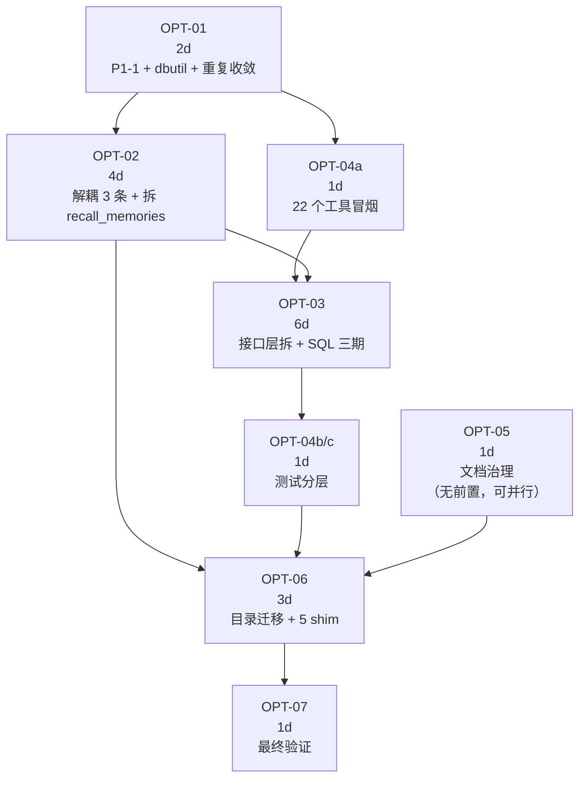

# Bionic Agent MCP — 架构优化任务清单（OPT-01 ~ OPT-07）

> 配套报告：`docs/ARCHITECTURE_OPTIMIZATION_PHASE1_REPORT.md`
> 本文件性质：**方案清单，不是执行记录**。本轮未执行任何一项。
> 每个任务都写明：修改范围、目标文件、**不修改范围**、风险、前置依赖、验收标准、回滚方式。

## 通用约束（对 OPT-01 ~ OPT-07 全部生效）

| # | 约束 |
| ---: | --- |
| 1 | **禁止**改 MCP 工具名 / 参数 / 返回结构（85 个） |
| 2 | **禁止**改 CLI 命令与参数（`scripts/*.py` 的 argparse 与三个 console entry） |
| 3 | **禁止**改记忆评分 / 检索 / 遗忘 / 冲突检测等核心算法参数（α、短语表、seed 阈值、`RECALL_WEIGHTS`、`_SYNONYM_GROUPS`） |
| 4 | **禁止**改已有测试的预期值、gold、题库、阈值 |
| 5 | **禁止**改数据库 schema，禁止对生产库写 / 迁移 / 恢复 / 破坏性测试 |
| 6 | **禁止**改备份包格式（`FORMAT_VERSION=1`）、21 项校验语义、恢复状态机 18 状态与 token TTL |
| 7 | **禁止** `git reset --hard`、`git checkout .`、`git clean -fd`、`git add -A`、`git add .` |
| 8 | **禁止**删除、覆盖、清理现有未跟踪文件（含 `scripts/dev/` 51 个、`data/`、`logs/`） |
| 9 | 涉及 DB 写入/迁移/恢复/删除的测试**必须**用独立临时库（`BIONIC_DB_PATH` 或 `db.DB_PATH` 指向 temp） |
| 10 | 每期结束必须：`python tests/run_tests.py` 全绿 + `compileall` rc=0 + 六套评测逐位一致 + 生产库指纹不变 |

**六套评测基线（每期都必须逐位一致）**

| 评测 | 基线 |
| --- | --- |
| 45 题检索 | `R@1 0.7317 / R@3 0.9268 / R@5 0.9268 / MRR@5 0.8211 / nDCG@5 0.8484` |
| 24 题意图 | `@1 19/24 / @3 24/24 / 反例误命中 2/24` |
| 48 题标题自召回 | `@1 47/48 / @3 48/48` |
| 38 题知识库 | `recall@1 38/38 / recall@3 38/38` |
| 口语题 NL（8 条） | `@1 5/8 / @3 8/8` |
| 纯语义 PURE（3 条） | `@1 1/3 / @3 3/3` |

**生产数据基线（每期前后核对）**

| 项 | 基线值 |
| --- | --- |
| `data/agent.db` sha256 | `19D8CE986EA44F56E62908683CBE1E45EAF1A4ACD193AABDCB6ACE697D3EFA4E` |
| size / mtime | `8581120` / `2026-11-19T10:44:59.3862755Z` |
| `-wal` / `-shm` | 均不存在 |
| `registry.json` sha256 | `C9591B7DE3EC8B7E836D95805BBE9F9C72ADBE7BA2F3DE5D01E7DC31F624CF67` |
| `记忆.jsonl` sha256 | `F80E550D3BD64F1D2EF170F4FC10C7F9F85F663CA8068C1D8256C17BA3D63499` |
| 测试基线 | 33/33 全绿 / 71.2 秒 |

---

# OPT-01 基础设施与公共模块治理

## 目标

修掉唯一有实测可复现危害的缺陷（P1-1），并把三组真重复函数收敛成单一实现，同时消除同语义常量漂移（P2-4）。**不碰任何业务算法。**

## 修改范围

**新建 1 个文件**

| 文件 | 内容 |
| --- | --- |
| `app/core/dbutil.py` | ①`readonly_uri(path, *, immutable=False) -> str` ②`immutable_uri(path) -> str` ③`sidecar_snapshot(db_path) -> dict` ④`wal_has_content(db_path) -> bool` ⑤`table_exists(conn, name) -> bool` ⑥`table_columns(conn, name) -> tuple[str, ...]` ⑦`pk_columns(conn, table) -> list[str]` ⑧`NON_RESTORABLE_TABLES: frozenset` |

**改 6 个文件（只改调用点，不改逻辑）**

| 文件 | 改动 |
| --- | --- |
| `app/portable_backup.py:409` | `f"file:{db_path}?mode=ro"` → `dbutil.readonly_uri(db_path)` |
| `app/portable_restore.py:229/396/654/795/918/1323/1417` | 7 处同样替换（**这是 P1-1 的实质修复**） |
| `app/portable_backup.py:178/190/205` | 删本地 `_sidecar_snapshot`/`_wal_has_content`/`_readonly_uri`，改 import |
| `app/db.py:185/200` | 删本地 `_sidecar_snapshot`/`_wal_has_content`，改 import（**函数体内逻辑零改动**） |
| `app/db_backup.py:139/152` | 删本地 `_readonly_uri`/`_immutable_uri`，改 import |
| `app/governance_conflicts.py:21` | `COEXISTING_CATEGORIES` 改为 `from app.governance_rules import COEXISTING_CATEGORIES`（采用 **7 项含 `interest`** 的那份，与 `load_rules()` 实际返回值一致） |

## 不修改范围

- 任何业务算法、权重、阈值、短语表
- `app/db.py` 的 `probe_database_state` / `init_db` 四分支逻辑（只替换其中的 sidecar/wal 辅助函数调用）
- `app/db_backup.py` 的 `create_physical_backup` 顺序（临时名 → 验证 → `os.replace` → 独立 try/except 清理）
- `app/portable_restore.py` 的状态机与令牌逻辑
- 任何测试的预期值

## 风险

| 风险 | 等级 | 缓解 |
| --- | --- | --- |
| `readonly_uri` 替换后路径行为变化 | 低 | 8 处替换逐个验证：含空格/中文/`#`/`%` 的 8 种路径名全部能读 |
| `COEXISTING_CATEGORIES` 改用 7 项版 | 低 | 该值本就是 `load_rules()` 的实际输出，6 项版是死回退（从未生效）。改后**行为零变化** |
| 循环导入（`dbutil` 被 `db.py` 依赖） | 低 | `dbutil` 只 import 标准库（`pathlib`/`urllib.parse`/`sqlite3`），不 import 任何 `app` 模块 |
| `app/db.py` 内部引用自身私有函数的地方漏改 | 中 | 改完全局 grep `_sidecar_snapshot|_wal_has_content` 确认 0 残留 |

## 前置依赖

无（这是第一个任务）。

## 验收标准

1. **P1-1 缺陷关闭**：构造 `hash#1.db` / `pct%20.db` / `a b.db` / `中文.db` / `amp&1.db` / `plus+1.db` / `semi;1.db` / `at@1.db` 八个库，全部能通过 `readonly_uri` 正常读到表；**目录里不产生任何 0 字节垃圾文件**
2. `grep -r "_sidecar_snapshot\|_wal_has_content\|_readonly_uri\|_immutable_uri" app/` 只在 `app/core/dbutil.py` 有定义
3. `grep -r "COEXISTING_CATEGORIES" app/` 只在 `app/governance_rules.py` 有定义
4. `python tests/run_tests.py` → **33/33 全绿**
5. `python -X utf8 -m compileall -q app scripts tests` → rc=0
6. 六套评测逐位一致（见通用约束表）
7. 生产库三层指纹 + registry + `记忆.jsonl` 不变

## 回滚方式

单批统一回滚：`git diff` 明确，`git checkout -- <6个文件>` + 删 `app/core/dbutil.py`。因为不改逻辑只换调用点，回滚无副作用。

**预计**：2 天

---

# OPT-02 业务模块解耦

## 目标

断开三条方向不合理的依赖（C-1 业务→入口、C-2 算法→知识私有、C-3 备份→治理），并把 208 行的 `recall_memories` 拆成四段却保持分数逐位不变。

## 修改范围

### 2.1 断开 C-1（业务层依赖入口层）

| 位置 | 现状 | 目标 |
| --- | --- | --- |
| `app/memory_lifecycle.py:809` | `from app import mcp_server as _mcp`（函数内延迟） | 先把被调用的那个函数的能力抽成业务层函数；`memory_lifecycle` 只依赖业务层 |

> **前置勘察要求**：先确认 `:809` 到底调用了 `mcp_server` 的什么（是某个工具函数还是 `_event`？），**把依赖目标查清楚再决定抽法**，不要以"反正是反向依赖"为由直接删。

### 2.2 断开 C-2（算法层依赖知识库私有函数）

| 位置 | 现状 | 目标 |
| --- | --- | --- |
| `app/memory_lexical.py:35` | `from app.knowledge import _SYNONYM_GROUPS, _segments` | `_segments` 与 `_SYNONYM_GROUPS` 提为公开 API（`segments()` / `SYNONYM_GROUPS`），或迁到 `app/core/text.py`；`memory_lexical` 只依赖公开接口 |

> **红线**：`_SYNONYM_GROUPS` 的 26 组内容**一个字都不能改**（知识库检索与词法检索共用）。

### 2.3 断开 C-3（备份层依赖治理层）

| 位置 | 现状 | 目标 |
| --- | --- | --- |
| `app/snapshots.py` → `app/governance_maintenance.py` | 拍快照会拉起治理链 | 查清是哪个符号（大概率是事件记录或规则版本），把该符号下沉到 `app/core/`；`snapshots` 只依赖 `core/` |

### 2.4 拆 `recall_memories`（`app/memory_lifecycle.py:438-645`，208 行）

| 拆出文件 | 内容 | 输入 → 输出 |
| --- | --- | --- |
| `app/memory/seed.py` | seed 门（`sem >= 0.45 or lex >= LEX_SEED_THRESHOLD`） | `rows, sem, lex` → `list[int]` |
| `app/memory/fusion.py` | 逐行 `parts` 组装 + 加权求和 + 类型乘子 + 过期降权 | `rows, sem, lex, spread, fb, weights` → `dict[mid, score]` |
| `app/memory/recall.py` | 编排：读行 → 打分 → seed → 扩散 → 融合 → 排序 → 记账 | 保持 `recall_memories(...)` 签名**完全不变** |

## 不修改范围

- `RECALL_WEIGHTS` 的 7 个数值
- `LEX_SEED_THRESHOLD`（0.3）与 `0.45` 的语义阈值
- 概念桥 α / 短语表 / `apply_intent_suppression` 的 0.45 抑制因子
- `RECALL_FEEDBACK_WEIGHT`（0.06）
- 稳定排序键 `(score, updated_at, id)`
- `explain` 输出的字段集（`_explain`/`_weights`/`_profile`/`_weights`/`_bridge` 等）
- `min_score` 的默认 `None`
- `record_access` 的记账时机（在拿到 result 之后）

## 风险

| 风险 | 等级 | 缓解 |
| --- | --- | --- |
| **拆分导致分数末位漂移** | **高** | 拆分只做"代码搬家"，**不重排任何算术表达式**；每拆一段立即跑六套评测；用一个"拆前/拆后分数 dict 全等"的临时脚本做逐字节比对 |
| `round(x, 6)` 调用位置变化 | 高 | `round` 的位置是语义的一部分（`_score` 是 6 位），必须原样保留 |
| C-2 抽取改变 `_segments` 行为 | 中 | 抽取是"改名 + 移动"，函数体逐字不动；抽完跑 `tests/lexical_test.py` + `tests/knowledge_test.py` |
| C-1 抽错能力 | 中 | 先勘察再抽；抽不出就把该函数改为**接收注入的回调**，而不是硬删依赖 |

## 前置依赖

**OPT-01 完成**（需要 `app/core/` 已存在作为下沉目标）。

## 验收标准

1. `grep "from app import mcp_server" app/memory_lifecycle.py` → **0 命中**
2. `grep "from app.knowledge import _" app/memory_lexical.py` → **0 命中**（不再 import 私有符号）
3. `grep "governance_maintenance" app/snapshots.py` → **0 命中**
4. 拆前后 `recall_memories` 对同一批 query 返回的 `[(id, _score)]` 序列**逐位相同**（用 45 题 + 24 题 + 焦点 7 条全量比对）
5. 六套评测逐位一致
6. `python tests/run_tests.py` → 33/33
7. 33 个测试文件的预期值**一个都没改**（`git diff tests/` 应为空）

## 回滚方式

按 2.1 / 2.2 / 2.3 / 2.4 四个子任务独立回滚，互不牵连。2.4 风险最高，单独一个 commit 单元。

**预计**：4 天

---

# OPT-03 MCP 接口层整理

## 目标

把 85 个工具从单文件 1738 行拆成按域分文件，并把 26 个工具函数体内的 SQL（67 处）分三期下沉到 `stores/`。**工具契约零变化。**

## 修改范围

### 3.1 拆分 `app/mcp_server.py`（1738 行 → 3 个文件 + shim）

| 目标文件 | 内容 | 行数估计 |
| --- | --- | --- |
| `app/mcp/core_tools.py` | `@mcp.tool()` 36 个 | ~700 |
| `app/mcp/gov_tools.py` | `@mcp_gov.tool()` 49 个 | ~800 |
| `app/mcp/server.py` | `mcp = FastMCP(...)`、`mcp_gov = FastMCP(...)`、`_ensure_db()`、`_event()`、`_tool_result()`/`_tool_error()`、`_run_cli()` | ~150 |
| `app/mcp_server.py` | **保留 shim**：`from app.mcp.server import mcp, mcp_gov, _run_cli` | ~10 |

### 3.2 SQL 下沉（P1-2，分三期，**顺序不可颠倒**）

| 期 | 工具 | 现状 SQL 数 | 目标 |
| --- | --- | ---: | --- |
| 一期 | `save_memory`(4)、`get_memory`(1)、`update_memory`(3)、`archive_memory`(2)、`restore_memory`(3)、`supersede_memory`(6) | 19 | `app/stores/memory_store.py` |
| 二期 | `create_task`(3)、`list_tasks`(1)、`get_task`(2)、`save_stage_snapshot`(4)、`handoff_task`(6)、`complete_task`(2)、`fail_task`、`resume_task`、`get_resume_packet` | 18+ | `app/stores/task_store.py` |
| 三期 | `link_memories`(4)、`get_memory_links`(2)、`list_events`(2)、`set_memory_expiry`(3)、`embedding_status`(3)、`index_memories`(2)、`semantic_search_memories`(2)、`search_memories`(2)、`find_related_memories`(2)、`backfill_memory_types`(3)、`classify_memory`(1)、`get_memory_lifecycle`(1)、`assess_memory_protection`(1)、`summarize_protection`(1) | 30 | `app/stores/event_store.py` + 各域 store |

### 3.3 同时处理 `app/admin_ui.py` 的 12 处 SQL（7 个路由）

| 路由 | SQL 数 |
| --- | ---: |
| `api_stats` | 6 |
| `_attach_governance` / `api_memories_timeline` / `api_memories_breakdown` / `api_score` / `api_protection_summary` / `api_protection_one` | 各 1 |

> 这 12 处可随 3.2 同一批下沉，也可单独一批（建议单独，因为面板不是 MCP 契约面）。

## 不修改范围

- **85 个工具的函数名、参数名、参数类型、默认值、返回结构**（逐个用 `verify_mcp_split_test.py` 的 `CORE_EXPECTED`/`GOV_EXPECTED` 核对）
- 75 个 HTTP 路由的路径、方法、请求体、响应体
- `_tool_result` / `_tool_error` 的语义
- 工具 docstring 的文字内容（可补但不删）
- `pyproject.toml` 的三个 console entry 名

## 风险

| 风险 | 等级 | 缓解 |
| --- | --- | --- |
| **工具注册顺序变化** | 中 | FastMCP 的工具表是 dict，顺序不影响调用；但 `verify_mcp_split_test` 会核对清单，改后必须仍 6 项全过 |
| 循环导入（`core_tools` ↔ `gov_tools`） | 中 | 两个文件互不 import，只 import `app.mcp.server` 的 `mcp`/`mcp_gov` 对象 |
| store 层引入事务边界变化 | **高** | store 函数接收调用方传入的 `conn`（不自己开事务），事务边界仍由工具函数决定 |
| SQL 下沉时把 `_ensure_db()` 的时机改了 | 中 | `_ensure_db()` 保持在工具函数第一行 |
| shim 漏建导致 `-m app.mcp_server` 失效 | **高** | 拆分后必须实测 `python -m app.mcp_server` 能起来（用 `--help` 或 3 秒超时探测） |

## 前置依赖

**OPT-04a（补 22 个工具冒烟）必须完成** —— 这是 P1-2 的安全网。没有它，下沉 SQL 等于在无测试的代码上动手术。

## 验收标准

1. `python -c "from app.mcp_server import mcp, mcp_gov"` → 成功
2. `python -m app.mcp_server` 能启动（不连 MCP 宿主也能探活）
3. `python tests/verify_mcp_split_test.py` → core=36 / gov=49 / 合计 85 / 6 项全 PASS
4. 工具名集合与拆分前**完全一致**（`set` 差集为空，两个方向都要查）
5. `python tests/run_tests.py` → 33/33（含新增的 22 个冒烟 = 34/34）
6. `grep -c "\.execute(" app/mcp/*.py` → **0**
7. 六套评测逐位一致（接口层重排不应影响检索，但要验）

## 回滚方式

按 3.1（拆文件）、3.2 一期、3.2 二期、3.2 三期、3.3（面板）**五个独立单元**回滚。3.1 与 3.2 之间可交错（先拆文件再下沉 SQL，或反之），但**同一单元内不可半途**。

**预计**：6 天

---

# OPT-04 测试体系优化

## 目标

把 33 个套件分 `unit/` / `integration/` / `security/` 三层，运行器支持子目录递归与 `--fast` 开关。**不改任何测试内容与预期值。**

## 修改范围

### 4a. 补 22 个零覆盖工具的冒烟测试（P2-3，**可独立先行**）

| 目标文件 | 内容 |
| --- | --- |
| `tests/mcp_tools_smoke_test.py` | 22 个工具各 2 条：①正常调用（最小合法参数）②非法参数（缺参/类型错/不存在的 id），断言**不抛未捕获异常**且返回结构含预期键 |

22 个工具清单：`search_memories`、`find_related_memories`、`get_memory_links`、`get_memory`、`update_memory`、`list_tasks`、`get_task`、`list_events`、`index_memories`、`get_memory_governance_status`、`supersede_memory_from_conflict`、`get_governance_action`、`plan_memory_cleanup`、`get_governance_run`、`get_vector_consistency`、`get_memory_details`、`get_related_memories`、`find_duplicate_memories`、`list_memory_relations`、`get_memory_lifecycle`、`run_memory_consolidation`、`get_memory_usage_stats`

> **必须**用独立临时库（`BIONIC_DB_PATH`），**禁止**连生产库。

### 4b. 目录分层（33 个套件迁移）

| 目标目录 | 套件 | 理由 |
| --- | --- | --- |
| `tests/unit/` | `concept_bridge_test`、`concept_bridge_diag_test`、`recall_profile_test`、`lexical_test`、`fusion_test`、`semantic_test`、`knowledge_test` | 7 个纯函数/纯算法，不建库 |
| `tests/security/` | `admin_host_guard_test`、`admin_backup_restore_test`、`verify_mcp_split_test` | 3 个守安全边界与契约 |
| `tests/integration/` | 其余 23 个 | 需要真库 |

### 4c. 运行器改造

| 改动 | 说明 |
| --- | --- |
| `discover()` 改为 `rglob("*_test.py")` | 支持子目录，仍需排除自身 |
| 新增 `--fast` | 只跑 `tests/unit/`（预计 < 10 秒） |
| 新增 `--layer unit|integration|security` | 按层跑 |
| 保留 `--only` / `--list` / `--stop` | 行为不变 |

## 不修改范围

- 任何测试的**检查点内容、预期值、阈值、gold**
- `tests/lexical_test.py` 的门槛（`融合 @1 ≥ 5`、`标题自召回 @1 ≥ 90%` 等）
- `tests/run_tests.py` 的 `CREATE_NEW_PROCESS_GROUP` 与 `PYTHONOPTIMIZE=""` 逻辑
- `run_tests_optimize_test.py` 的存在（它是运行器的回归测试）

## 风险

| 风险 | 等级 | 缓解 |
| --- | --- | --- |
| 迁移后相对路径失效 | 中 | 所有测试都有 `ROOT = Path(__file__).resolve().parent.parent`，迁到子目录后要改成 `.parent.parent.parent`。**逐个核对**，用 compileall + 实跑双重验证 |
| `run_tests.py` 自身路径推断 | 中 | `TESTS = ROOT / "tests"` 不变，只是 `glob` 变 `rglob` |
| 22 个冒烟引入对生产库的写入 | **高** | 每个测试首行设 `BIONIC_DB_PATH` 到 temp；末尾断言生产库指纹不变 |
| 冒烟测试触发真实 embedding 加载 | 中 | 若太慢，`index_memories`/`semantic_search_memories` 的冒烟可只测"非法参数"分支，正常分支标 `skip` 并在报告里说明 |

## 前置依赖

**4a 无前置**（可最早做，推荐紧跟 OPT-01）。**4b/4c 需要 OPT-02 之后**（目录稳定了再分层）。

## 验收标准

1. `python tests/run_tests.py` → **34/34**（33 + 新增冒烟套件）
2. `python tests/run_tests.py --fast` → 7/7，耗时 **< 10 秒**
3. `python tests/run_tests.py --layer security` → 3/3
4. 22 个工具从"完全无覆盖"变为"有冒烟"，覆盖率清单可查
5. 每个测试文件的 `ROOT` 推断正确（实跑验证，非靠读代码）
6. 生产库指纹不变

## 回滚方式

4a 是纯新增文件（删掉即回滚）。4b/4c 是路径调整，一次性 `git mv` 回来即可。

**预计**：2 天

---

# OPT-05 文档治理

## 目标

修正 README 的 4 处实测不一致（D-1~D-4），建立 `docs/README.md` 索引。**不重组现有文档内容到别的文件**（那是 OPT-06 之后的事）。

## 修改范围

| 文件 | 改动 |
| --- | --- |
| `README.md:584` | `snapshot_test`「31 项」→「**57 项**」 |
| `README.md:586` | `distillation_test`「37 项」→「**39 项**」 |
| `README.md:356-375` 项目结构段 | 补 13 个未列模块：`db_backup`/`memory_lexical`/`portable_backup`/`portable_restore`/`snapshots`/`knowledge`/`recall_profile`/`protection`/`expiry`/`star_map`/`task_resume`/`feedback_loop`/`distillation`；补 `docs/` 与 `scripts/` 子目录说明 |
| `docs/README.md` | **新建**：文档索引（指向 4 个架构文件 + 未来的 9 个专题文件） |
| `.env.example` | 从 3 行补到覆盖 30 个环境变量（按 `BIONIC_DB_*` / `BIONIC_EMBEDDING_*` / `BIONIC_GOV_*` / `DSH_MEMORY_ROOT` 分组，每项带一行注释） |

## 不修改范围

- README 的「九个"不显然"的设计决定」全文（每一条都是历史决策记录）
- README 的「功能总览」「快速开始」「面板用法」
- 任何其他数字（**未经实跑核实的数字一个都不改**）
- `docs/ARCHITECTURE_AUDIT_S0_S6.md` / `ARCHITECTURE_FILE_INVENTORY.csv` / 本轮两份报告

## 风险

| 风险 | 等级 | 缓解 |
| --- | --- | --- |
| 改错数字（把对的改成错的） | **中** | **每个数字都实跑核实后才改**：`snapshot_test` 跑一次看「共 N 项」，`distillation_test` 同样 |
| README 是 CRLF（635 行全 CRLF 无 BOM） | 低 | 编辑后核对 `CRLF=634 / LF=635 / BOM=False` 与原状一致 |
| `.env.example` 写出不存在的变量 | 低 | 只从本轮实测的 30 个清单里取，不臆造 |

## 前置依赖

无（纯文档，可与任何代码任务并行）。

## 验收标准

1. `README.md` 20 行测试数字与实跑**全部一致**（逐项核对）
2. README 项目结构段的 `app/` 条目数 == 26（或明确写「其余 N 个见 docs/」）
3. `docs/README.md` 存在且 4 个现有文档全部被引用
4. `.env.example` 行数覆盖 30 个变量
5. `README.md` 换行风格未变（CRLF / 无 BOM）

## 回滚方式

`git checkout -- README.md .env.example` + 删 `docs/README.md`。

**预计**：1 天

---

# OPT-06 目录迁移

## 目标

按报告 §12.2 的目标树迁移文件，**保留 5 个 shim**，同步改 `pyproject.toml` / `build_zip.py` / `STATIC_DIR`。

## 修改范围

### 6.1 建目录并迁移 `app/`（26 → 6 个子包）

见报告 §13.1 的完整映射表（46 行）。

### 6.2 建 5 个 shim（**这是本任务最关键的部分**）

| shim 文件 | 内容 | 保护的外部依赖 |
| --- | --- | --- |
| `app/mcp_server.py` | `from app.mcp.server import *` + `_run_cli` | DSH `registry.json`：`-m app.mcp_server` |
| `app/mcp_server_gov.py` | 同上（governance） | `-m app.mcp_server_gov` |
| `app/admin_ui.py` | `from app.api.app import app` + `_run_cli` + `main` | `dsh-panel-client/lib/index.js:227` 的 spawn |
| `scripts/snapshot_db.py` | 转调 `scripts/ops/snapshot_db.py` 的 `main()` | `Invoke-DshTask.ps1` 的 `$plans['Snapshot']`（05:00 备份链） |
| `app/__init__.py` | 空（保持不变） | — |

### 6.3 同步修改的配置点（**漏一个就废一个功能**）

| 文件 | 改动 |
| --- | --- |
| `pyproject.toml:26` | `package-data` 的 `admin_ui.html` → `api/templates/index.html`；`static/*` → `api/templates/static/*` |
| `pyproject.toml:29-31` | 三个 console entry 的模块路径跟着改（`app.mcp_server` / `app.mcp_server_gov` / `app.admin_ui` **名字不变**，若 shim 保留则可完全不改） |
| `app/api/app.py`（原 `admin_ui.py:1378`） | `STATIC_DIR = Path(__file__).parent / "templates" / "static"` |
| `app/api/app.py` 的 `index()` | `admin_ui.html` → `templates/index.html` |
| `build_zip.py:14` | `INCLUDE_DIRS` 保持 `["app", "dsh-panel-client", "scripts"]`（已覆盖子目录）；`SCRIPTS_ALLOW` 需按新路径调整 |
| `build_zip.py` 的 `_excluded()` | `eval_` 前缀规则可删（改为目录排除），但**保留也无害** |
| `tests/` 所有文件的 `ROOT` 推断 | 迁到子目录后多为 `parent.parent.parent` |

## 不修改范围

- 任何文件内容（迁移是 `git mv` + import 路径调整，**不改逻辑**）
- `data/` 目录结构
- `dsh-panel-client/` 内部结构
- `docs/` 现有文件位置
- `scripts/dev/`（不动，用户资产）

## 风险

| 风险 | 等级 | 缓解 |
| --- | --- | --- |
| **shim 遗漏 → MCP 服务直接挂** | **极高** | 5 个 shim 逐个实测：`python -m app.mcp_server` / `-m app.mcp_server_gov` / `-m app.admin_ui` / `python scripts/snapshot_db.py --dry-run` / `python -c "from app.mcp_server import mcp"` |
| `pyproject` 的 `package-data` 漏改 → wheel 缺前端 | **极高** | 迁移后**重建 wheel 并解包检查** `templates/index.html` 与 `templates/static/3d-force-graph.min.js` 都在 |
| 05:00 备份链断 | **高** | 迁移后手动跑一次 `snapshot_db.py --dry-run`；**明早 05:00 后核对 `logs/snapshot.log`** |
| 循环导入因目录层级变化暴露 | 中 | 迁移前先完成 OPT-02（依赖方向已理顺） |
| `git mv` 后旧路径的 `__pycache__` 残留 | 低 | 迁移后清 `__pycache__` |

## 前置依赖

**OPT-02（依赖理顺）+ OPT-03（接口层已拆）+ OPT-04（测试已分层）全部完成。** 迁移必须是"逻辑已稳定"之后的最后一步动作。

## 验收标准

1. 5 个 shim 全部实测可用（见上表风险缓解列的 5 条命令）
2. `python tests/run_tests.py` → 34/34
3. `python -X utf8 -m compileall -q app scripts tests` → rc=0
4. **重建 wheel**：`pip wheel . --no-deps --no-build-isolation` → 解包检查 `app/api/templates/index.html` + `app/api/templates/static/3d-force-graph.min.js` 存在
5. **重建 ZIP**：`build_zip.iter_files()` → 无 `tests/`、无 `data/`、无 `logs/`、无 `scripts/dev/`
6. 六套评测逐位一致
7. `git archive HEAD` 后能 `import app.mcp_server`
8. `scripts/snapshot_db.py --dry-run` rc=0
9. 生产库指纹不变

## 回滚方式

整批 `git revert`（若已 commit）或 `git mv` 反向。**因为保留 shim，旧路径在迁移期间一直可用** —— 这是允许"迁一半先观察"的前提。

**预计**：3 天

---

# OPT-07 最终架构验证

## 目标

**不写任何代码**。只做全量验收，出验收报告。

## 验证范围

| # | 验证项 | 通过标准 |
| ---: | --- | --- |
| 1 | 全量测试 | `python tests/run_tests.py` → 34/34 / exit=0 / stderr 0 字节 |
| 2 | 编译 | `python -X utf8 -m compileall -q app scripts tests` → rc=0 |
| 3 | 六套评测 | 45/24/48/38/NL/PURE **逐位一致**（与 OPT-01 前基线比对） |
| 4 | MCP 工具契约 | core 36 / gov 49 / 合计 85 / 交集空 / 名集合与迁移前完全一致 |
| 5 | MCP 启动 | `python -m app.mcp_server` 与 `-m app.mcp_server_gov` 均可启动 |
| 6 | 面板 | `python -m app.admin_ui --port <临时>` 能起，GET `/` 200，GET `/static/3d-force-graph.min.js` 200 |
| 7 | 面板守卫 | `--host 0.0.0.0` 仍 exit=2；`--allow-remote` 能起 |
| 8 | 备份三路 | 逻辑快照 / 物理备份 / 便携包各跑一次（**在临时库上**），产物可读、可校验 |
| 9 | 恢复 | 用临时库做一次 preview → confirm → execute → verify 全流程 |
| 10 | 05:00 计划任务 | `scripts/snapshot_db.py --dry-run` rc=0；次日核对 `logs/snapshot.log` |
| 11 | 生产数据 | sha256 / size / mtime / `-wal` / `-shm` / registry / `记忆.jsonl` 全部与基线一致 |
| 12 | wheel | 解包含 `templates/index.html` + `templates/static/*.js` |
| 13 | ZIP | 无 `tests/`/`data/`/`logs/`/`scripts/dev/` |
| 14 | 依赖方向 | 3 条不合理依赖已断（C-1/C-2/C-3 的 grep 全部 0 命中） |
| 15 | 接口层纯度 | `grep -c "\.execute(" app/mcp/*.py app/api/routes/*.py` → 全 0 |
| 16 | 重复收敛 | `_readonly_uri`/`_sidecar_snapshot`/`_wal_has_content` 各只剩 1 处定义；`COEXISTING_CATEGORIES` 只剩 1 处 |

## 不修改范围

**全部** —— 本任务只读，唯一写入物是验收报告 `docs/ARCHITECTURE_OPTIMIZATION_VERIFY_REPORT.md`。

## 风险

| 风险 | 等级 | 缓解 |
| --- | --- | --- |
| 验收时误连生产库做恢复演练 | **高** | 所有恢复演练必须 `BIONIC_DB_PATH=<temp>`；**发现连了生产库立即停止并报告** |
| 把"某次通过"当成"架构稳定" | 中 | 测试跑 2 遍（防偶发）；评测跑 1 遍但逐位比对 |

## 前置依赖

OPT-01 ~ OPT-06 全部完成。

## 验收标准

上表 16 项**全部 PASS**（不允许"大部分通过"）。任一项 FAIL 则回到对应期修复，不进入下一阶段。

## 回滚方式

无需回滚（只读）。

**预计**：1 天

---

# 附：任务依赖与建议排期

| 期 | 任务 | 天数 | 累计 |
| ---: | --- | ---: | ---: |
| 1 | OPT-01 | 2 | 2 |
| 2 | OPT-04a（冒烟，先做） | 1 | 3 |
| 3 | OPT-02 | 4 | 7 |
| 4 | OPT-03 | 6 | 13 |
| 5 | OPT-04b/c（分层） | 1 | 14 |
| 6 | OPT-05（可并行） | 1 | 15 |
| 7 | OPT-06 | 3 | 18 |
| 8 | OPT-07 | 1 | 19 |

**合计约 19 个工作日**（不含评审与返工）。

## 三个"绝不能颠倒"的顺序

1. **OPT-04a（补 22 个工具冒烟）必须在 OPT-03（SQL 下沉）之前** —— 否则是在零测试的代码上动手术。
2. **OPT-02（依赖理顺）必须在 OPT-06（目录迁移）之前** —— 否则迁移时会把循环依赖一起搬进新结构。
3. **OPT-06（目录迁移）必须排在所有逻辑改动之后** —— 避免"代码改一半 + 目录动过"的双变量排错。

## 三个"可以立即开始"的任务

1. **OPT-01**（无前置，唯一实测缺陷）
2. **OPT-04a**（纯新增测试，无前置）
3. **OPT-05**（纯文档，无前置）
