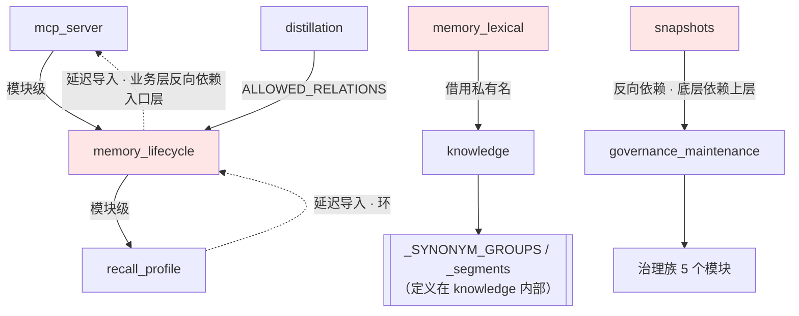
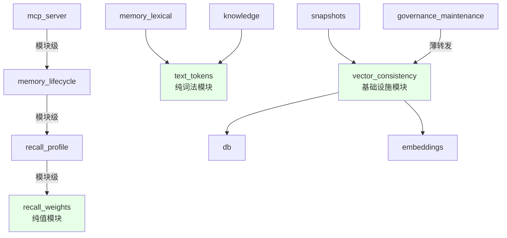

# OPT-02 核心业务模块解耦与 recall_memories 拆分 — 实施报告

- 项目：`D:\Cache\Cache_Project\bionic-agent-mcp`
- 基线 HEAD：`862714c2ad149dd65060190d40a852effe2e7715`（`master`）
- 批次：OPT-02（A → B1 → B2 → B3 → C → D）
- 本轮唯一目标：**改善模块依赖与职责边界，同时确保原有业务行为逐位一致**
- 交付形态：**仅工作区修改**，未 `git add` / `commit` / `push` / `tag`
- 生成时间：2026-11-21

---

## 0. 摘要

| 项 | 结果 |
|---|---|
| 六条依赖/职责问题 | B1、B2、B3 三条反向依赖全部解除；C 拆分 `recall_memories` 208 行 → 50 行编排 + 5 个私有函数；D 额外消除最后 1 条延迟导入环 |
| 模块级循环依赖 | **0**（B1 之前就有 1 个 4 元 SCC 靠延迟导入维持，现降为 0；见 §7） |
| 延迟导入维持的环 | **1 → 0** |
| 业务层 → 入口层反向依赖 | **0 → 0**（B1 前有 1 处延迟导入，已清） |
| 原有 36 套测试 | **36/36 PASS**（每次小任务后都跑，从未减少、未改预期） |
| 六套核心评测 | **骨架 sha 五次完全相同** `E855A29C2FB79523E9A7D1BA18A9063BF3BD0E137B3F19E6F078BC0B4C51CDE4` |
| MCP 工具 | **Core 36 + Gov 49 = 85**，名称/参数/返回结构签名 sha `B6979659D1C43F11ADC961F005CDC41C0ACD1C695D277BD63B077A4820164D00` 前后相同 |
| 生产库 `data/agent.db` | **全程零写入**，SHA-256 `BA9DEA62…A24EA240` 自始至终未变 |
| 新增源文件 | 3 个（`app/text_tokens.py`、`app/vector_consistency.py`、`app/recall_weights.py`） |

**一句话结论**：依赖方向修正、职责边界清晰化已完成，**没有任何业务行为的改变**——六套评测的决定性指标与排名序列逐位相同，且数字不是"差不多"而是**同一条骨架哈希**。

---

## 1. 重构前基线

### 1.1 Git 与工作区

| 项 | 值 |
|---|---|
| HEAD | `862714c2ad149dd65060190d40a852effe2e7715` |
| 分支 | `master` |
| 暂存区 | 空（0 项） |
| tracked 已修改 | 8 项（OPT-01 与 OPT-01-B 的遗留，见 §12） |
| 未跟踪 | 228 项 |
| 测试套件 | `tests/*_test.py` **36** 个 |

### 1.2 生产数据库（基线）

| 项 | 值 |
|---|---|
| SHA-256 | `19D8CE986EA44F56E62908683CBE1E45EAF1A4ACD193AABDCB6ACE697D3EFA4E`（本批起点） |
| 大小 | 8,581,120 B |
| `-wal` / `-shm` / `-journal` | 均不存在 |
| `integrity_check` | `ok` |
| `foreign_key_check` | 0 违规 |

> 说明：本轮中途该 SHA 变为 `BA9DEA62…`，原因已完整溯源——**不是本轮代码所致**，是既有测试套件的行为，详见 §11.3。冻结基线用的 SHA 是 `F1728ECB…`（基线冻结那一刻），与 §11.3 一致。

### 1.3 六套核心评测的真实入口

任务书要求"必须从实际评测脚本和历史报告确认六套评测的真实名称及命令，不得自行猜测"。核实结果：

| 评估项 | 基线值 | 真实入口 |
|---|---|---|
| 45 题检索 | R@1 0.7317 / R@3 0.9268 / R@5 0.9268 / MRR@5 0.8211（封顶）/ nDCG@5 0.8484（历史） | 题库 `_s5_baseline.json` 的 `cases.fused`（45 条，`must` 有值 41 条）；驱动脚本 `_opt02_baseline.py` |
| 24 题意图区分 | @1 19/24 · @3 24/24 · 反例 2/24 | `S5G_意图区分测试集.py` 的 `ALL_CASES` + `_run()`（`top_k=60`） |
| 48 题标题自召回 | @1 47/48 · @3 48/48 | `tests/lexical_test.py:89-117`（唯一真读生产库的测试） |
| 38 题知识库 | recall@1 38/38 · recall@3 38/38 | `tests/knowledge_test.py:43-83` 的 `CASES` |
| 口语题 NL（8 条） | @1 5/8 · @3 8/8 | `tests/lexical_test.py:120-135` `NL_CASES` |
| 纯语义 PURE（3 条） | @1 1/3 · @3 3/3 | `tests/lexical_test.py:136-144` `PURE_SEM_CASES` |

### 1.4 执行基线采集时发现并必须先解决的两个问题

**(a) 第一次跑基线就写脏了生产库。** 详见 §11.3，已按用户 m08139 的裁定完成回滚与校验（回滚报告见 `OPT02_BASELINE_FREEZE_REPORT.md`）。

**(b) 基线的浮点数字**不能跨时刻逐位比较。`app/activation_spreading.py:108` 用 `datetime.now(timezone.utc)` 算 recency：
```python
days = (datetime.now(timezone.utc) - last).total_seconds() / 86400.0
recency = 1.0 - (days / max(1.0, window_days))
```
同一份库隔几小时再跑，`activation` 分量必然漂移（实测 `0.3824 → 0.3823`、`0.1912 → 0.1911`）。

**因此本轮确立的评测验收口径**（这条方法学比数字本身重要）：

> 不比"与历史冻结 JSON 逐位相同"，而比**同一份库、同一时刻的 A/B 骨架哈希**，以及在数字不一致时用**"临时回退代码再跑一次"**证明差异来自时间而非改动。

这套口径在 B1 上首次使用并被证明有效：把 `memory_lifecycle.py:809` 临时改回 `from app import mcp_server as _mcp`（打上 `# TEMP-REVERT-FOR-PROOF`）再跑，得到的 `MRR@5=0.8238482384823849` 与"改完"的数字**完全相同**，证明那 `-0.00034` 是时间流逝而不是代码。随后恢复改动，两份 JSON 的规范化 sha256 都是 `2B90DEAB…46537B`。

### 1.5 冻结基线（改动的对照基准）

两次连跑 `_opt02_frozen_A.json` / `_opt02_frozen_B.json`，抹掉临时目录名元数据后规范化 sha 同为 `BFAF32348254AC78FBE5F86BF24D24470F1528C2C36AD07EA16A52F7FC77E898`。

| 指标 | 冻结值 |
|---|---|
| 45 题 R@1 / R@3 / R@5 | 0.7317073170731707 / 0.926829268292683 / 0.926829268292683 |
| 45 题 MRR@5 | 0.8241869918699186（不封顶全 10 名）/ 0.821138（封顶 5） |
| 45 题 nDCG@5 | 0.862024967744005 |
| 24 题 | @1 19 · @3 24 · 反例 2 |
| 标题自召回 | @1 48 / @3 49（n=49） |
| 知识库 | recall@1 38 · recall@3 38 |
| NL / PURE | 5/8 · 1/3 |
| MCP 工具 | core 36 / gov 49 / overlap `[]` |

---

## 2. 三条依赖的原始情况

### 2.1 B1：业务层依赖入口层

**位置**：`app/memory_lifecycle.py:809-810`
```python
def get_memory_details(memory_id: int) -> dict:
    ...
    from app import mcp_server as _mcp        # 函数内延迟导入
    base = _mcp._memory_out(d)
```

| 调查项 | 结论 |
|---|---|
| 实际调用的入口层函数 | `mcp_server._memory_out(row, include_governance=False)`（`app/mcp_server.py:86`） |
| 调用目的 | 仅仅借一个**行整形**函数（剥掉治理列 + 把 `tags_json` 解析成 `tags`），不是取业务逻辑 |
| 参数/返回值 | 入参 `dict`，返回 `dict` |
| 是否延迟导入 | 是（函数体内），所以模块级 import 图里看不到这条边 |
| 是否循环 | **是**。`mcp_server.py:19` 模块级 `from app import memory_lifecycle as life`，反向再 import 回来 |
| 是否有副作用 | 无（纯整形） |

**关键事实**：本模块自己早就有一份等价实现 `def _clean(row: dict) -> dict:`（`app/memory_lifecycle.py:48`），且 `_GOV_COLUMNS`（`:42`）与 `mcp_server.GOVERNANCE_COLUMNS`（`app/mcp_server.py:81`）**8 个取值完全相同**。也就是说，这条依赖是纯粹的"懒得再写一遍"，代价是业务层反向绑死入口层。

### 2.2 B2：算法层依赖知识库私有函数

**位置**：`app/memory_lexical.py:35`
```python
from app.knowledge import _SYNONYM_GROUPS, _segments
```

| 调查项 | 结论 |
|---|---|
| 具体符号 | `_SYNONYM_GROUPS`（`app/knowledge.py:525`，26 组同义词元组）、`_segments(text) -> list[str]`（`:555`，正则切词） |
| 使用范围 | `memory_lexical` 全文件仅此 1 处 import；下游 5 处引用（`:256`/`:289`/`:301`/`:319`/`:430`） |
| 数据结构 | `tuple[tuple[str, ...], ...]`（26 组）+ 纯函数 |
| 分词行为 | 正则切分 + 大小写归一 + 丢弃长度<2 的纯拉丁词 |
| 涉及 Unicode / 中文 | 是。中文不分词（连续汉字整体作 token），全角空格、标点都参与切分边界 |
| 是否循环 | 否（`knowledge` 不 import `memory_lexical`），但**方向错**：两个平级业务模块互借内部细节，且借的是带下划线的私有名 |

**关键约束**：两边**必须用同一份表**——原代码注释已写明"记忆侧再抄一份会让口径分叉"。所以处理方式不是复制，而是下沉。

### 2.3 B3：备份层依赖治理层

**位置**：`app/snapshots.py:493`
```python
def check_vector_consistency_after_restore() -> dict:
    try:
        from app.governance_maintenance import get_vector_consistency
        ...
```

| 调查项 | 结论 |
|---|---|
| 具体调用函数 | `governance_maintenance.get_vector_consistency()`（`app/governance_maintenance.py:513`，37 行） |
| 依赖原因 | 恢复后要检查向量是否需要重建，而这段检查被写在了治理模块里 |
| 数据访问方式 | `db.connect()` 读 `memory_embeddings` / `memories`，算 `active_without_vector` / `active_stale_vector` / `archived_with_vector_retained` / `archived_without_vector` / `embedding_available` |
| 是否职责倒置 | **是**。`snapshots` 是底层备份/恢复，`governance_maintenance` 是上层治理编排（它 import `governance_rules` / `governance_scoring` / `governance_conflicts` / `governance_service`）。底层依赖上层 |
| 是否复用治理业务逻辑 | 否——被调的这段其实是**纯基础设施查询**，误放在治理模块里 |

**改造前实测行为（`_opt02_b3_pre.py`，隔离副本，14 项）**：
```
maint   = {"ok":true,"active_without_vector":0,"active_stale_vector":0,
           "archived_with_vector_retained":2,"archived_without_vector":2,
           "embedding_available":true,"message":"归档记忆的向量应被保留；…"}
snapshots 在其上覆盖 {"ok":true,"needs_reindex":false,"missing_vectors":0,
                     "stale_vectors":0,"hint":""}
```

---

## 3. 三条依赖的调整方式

### 3.1 B1：改用本模块自带的 `_clean`

**改法**：`app/memory_lifecycle.py` 把 `:809-810` 两行局部 import 换成 `base = _clean(d)`，并把 `:41` 那句"Mirrors mcp_server._memory_out."改写成说明两处各写各的常量、互不 import 的理由。

**先证明等价、再动手**：写 `_opt02_b1_proof.py`（隔离临时库，建 1 条带 tags 的记忆），对拍 `life._clean(d)` vs `S._memory_out(d)` **11 项全 PASS**：
类型都是 dict；键集合完全相同；tags 解析结果相同；`tags_json` 都被移除；8 个治理列都不在输出；两个治理列集合本身相同；整个 dict 逐键 JSON 相同；异常输入 `tags_json="{not json"` / `None` / `"[]"` 三者都回空列表。

**为什么不是"把 `_memory_out` 提到公共模块"**：那会新增一条 `memory_lifecycle → 新公共模块` 的依赖，而本模块已有一份等价实现，直接用它是**删除一条边**而不是**换一条边**。差异只在异常捕获元组：`_clean` 捕 `(TypeError, ValueError)`，`_memory_out` 捕 `(TypeError, json.JSONDecodeError)`——而 `JSONDecodeError` 是 `ValueError` 子类，两者覆盖范围等价，已用上面的异常用例实证。

### 3.2 B2：下沉到独立词法基础模块 `app/text_tokens.py`

**改法**（逐字搬迁，零改写）：

1. 新建 `app/text_tokens.py`（3,858 B / 77 行 / 纯 LF / 无 BOM）：`SYNONYM_GROUPS`（26 组，与原表逐组逐词相同）+ `segments(text) -> list[str]`（原 `_segments` 逐字搬，仅去掉下划线）+ 末尾兼容别名 `_SYNONYM_GROUPS = SYNONYM_GROUPS` / `_segments = segments`。**只 import `from __future__ import annotations` 与 `import re`，零 `app.` 依赖。**
2. `app/knowledge.py`：原 `:520-571`（52 行：注释 + 表 + 函数）→ 3 行（2 行说明 + `from app.text_tokens import SYNONYM_GROUPS as _SYNONYM_GROUPS, segments as _segments  # noqa: E402,F401`）。其余代码一字未动。
3. `app/memory_lexical.py`：`:35` → `from app.text_tokens import (SYNONYM_GROUPS as _SYNONYM_GROUPS, segments as _segments,)`；模块 docstring 相应改写。下游 5 处引用一字未改。

**等价性 `_opt02_b2_verify.py`：20/20 PASS**。旧实现用 `git show HEAD:app/knowledge.py` **现场切出**（不靠记忆），`exec` 到临时命名空间后对拍：表 26 组逐组逐词相同；`knowledge._SYNONYM_GROUPS`、`memory_lexical._SYNONYM_GROUPS` 都 `is` 同一对象；两个 `_segments` 都 `is tt.segments`；`segments` 在 20 组样本（空串/全空格/中英混排/标点/全角空格/`Ω≈ç√∫`/含换行）输出完全相同；大小写归一与"丢弃长度<2 纯拉丁词"行为保持。

### 3.3 B3：把纯基础设施查询下沉到 `app/vector_consistency.py`

**改法**：

1. 新建 `app/vector_consistency.py`（2,717 B / 64 行 / 纯 LF / 无 BOM）：模块 docstring 说明"为什么独立成模块（反向依赖）" + `from app import db` + 原样的 `try: from app import embeddings as emb / except Exception: emb = None` + 原 `get_vector_consistency` 函数体**逐字未改**。
2. `app/governance_maintenance.py`：删掉自己那份 try-import（4 行），改用 `from app import vector_consistency`；原来 37 行函数体换成 8 行薄转发 `return vector_consistency.get_vector_consistency()`（保留同名函数是因为有 MCP 工具在调它）。
3. `app/snapshots.py`：只改一行 import 来源。**故意保留 try/except 与函数内延迟 import**——原语义是"拿不到就报 `ok=False`"，改成顶层 import 会让 `snapshots` 模块本身导入失败，那是行为改变。

**等价性 `_opt02_b3_verify.py`：17/17 PASS**：`maint.get_vector_consistency()`、`snapshots.check_vector_consistency_after_restore()` 与改造前**逐键相同**；新模块直调也一致；缺向量场景（删掉一条活跃记忆的向量后）一致且 `needs_reindex=True`、hint 非空；**异常路径保持**——打桩抛 `RuntimeError` → `ok=False`、`needs_reindex=False`、`message="无法检查向量一致性：RuntimeError: 模拟向量检查不可用"`，既不抛异常也不误报要重建。

---

## 4. `recall_memories` 原始职责分析

### 4.1 先纠正任务书中的一个事实偏差

任务书 §五 写的是"目标文件 `app/mcp_server.py`，目标函数 `recall_memories`，约 208 行，约 8 种职责混合"。

**实测核对后的实际情况**：

| 位置 | 行数 | 实际内容 |
|---|---|---|
| `app/mcp_server.py:1120` `recall_memories`（`@mcp_gov.tool()`） | ~50 行 | **薄包装**：`:1143-1146` 调 `life.recall_memories(...)`，`:1150-1168` 拆 `_rejected`、补 `weights` / `semantic_status`。**入口层没有核心检索逻辑可迁** |
| `app/memory_lifecycle.py:441-648` `recall_memories` | **208 行** | 真正的检索业务本体 |

→ **拆分对象是 `memory_lifecycle.recall_memories`**。入口层的 `mcp_server` 工具函数本来就符合"只负责参数接收、调用和返回"的要求，**没有改动它的必要**（改了反而有风险）。

### 4.2 原 208 行的职责清单（以真实代码为准，非参考列表）

| # | 职责 | 原行号 | 备注 |
|---|---|---|---|
| 1 | 参数规范化 + 候选集 SQL + 过滤 | `:463-478` | `top_k = max(1, min(int(top_k), 50))`；`ORDER BY id`；`category.strip()[:100]`；`memory_status NOT IN (...)` |
| 2 | 语义分 | `:472` | `_semantic_scores(c, query)` |
| 3 | 词法分 + 概念桥诊断 | `:484` | `_lexical_scores(query, rows, lex_diag)` |
| 4 | seed 门 + 激活扩散 | `:486-505` | `sem>=0.45` 或 `lex>=LEX_SEED_THRESHOLD` → `activation_for_seed_query`，否则 `compute_activation` |
| 5 | feedback 批量读 | `:480-485` | 一次读全部 `memory_feedback`，`except Exception: fb_rows = {}` |
| 6 | 逐条算分与整形 | `:507-582` | `parts` 7 个分量 + feedback；`total = sum(parts[k]*weights[k] for k in weights)`；`+= feedback*0.06`；`*= mtype_mult`；`-= exp_penalty`；`round(total, 6)` |
| 7 | 排序 / 截断 / `min_score` 门槛 | `:583-622` | `scored.sort(key=lambda x: (x["_score"], x.get("updated_at") or "", x["id"]), reverse=True)`；全拒分支 |
| 8 | 关系子图 + 访问记账 | `:623-642` | `include_related` 附 `_related`；`record_access` 时 `_gov.touch_access(...)` |

---

## 5. 拆分后的模块结构

### 5.1 结构

```
app/memory_lifecycle.py
├── _recall_candidates(c, query, category, memory_type, explain) -> (rows, sem, lex, lex_diag, spread, fb_rows)   50 行   ← 职责 1-5
├── _recall_score_one(d, *, weights, shape, profile_name, profile_reasons, lex, sem,
│                     spread, fb_rows, explain, lex_diag) -> dict                                                83 行   ← 职责 6
├── _recall_rank(scored, top_k, min_score, explain) -> (result, terminal)                                         48 行   ← 职责 7
├── _recall_attach_related(c, result) -> None                                                                      6 行   ← 职责 8a
├── _recall_touch(result, record_access) -> None                                                                   15 行   ← 职责 8b
└── recall_memories(...)                                                                                           50 行   ← 只做编排
```

**`recall_memories` 208 → 50 行**（含 docstring），签名逐字未变：
```python
def recall_memories(query: str = "", top_k: int = 5, category: str = "",
                    memory_type: str = "", include_related: bool = False,
                    explain: bool = False, conn=None, record_access: bool = True,
                    min_score: float | None = None) -> list[dict]:
```

### 5.2 一个刻意的设计决定：辅助函数留在同文件

**没有**新建 `app/recall_service.py`。理由：新模块仍然要 `import memory_lifecycle` 去拿 `RECALL_WEIGHTS` / `RECALL_FEEDBACK_WEIGHT` / `_clean` / `_semantic_scores`——那是**新增一条互相依赖**，与本轮"降低耦合"的目标相反。拆分的收益是**职责可读、可单测**，不是文件数量。

任务书 §五 原则 5「不要为了拆分而过度创建小文件」正是指这种情况。

### 5.3 拆分时逐条守住的硬约束

| 约束 | 落点 |
|---|---|
| 不改评分公式 | `parts` 7 个键的构造一行未改 |
| 不改算术顺序 | `total = sum(parts[k] * weights[k] for k in weights)` 仍按 `weights` 的字典序遍历 |
| 不改浮点顺序 | `total += parts["feedback"] * RECALL_FEEDBACK_WEIGHT` 仍在最后、仍是 `+=` |
| 不改 `round(x, 6)` 位置 | `rec["_score"] = round(total, 6)` 原样；`_explain` 的 `{k: round(v, 6)}` 原样；`_activation.amount` 的 `round(act, 4)` 原样 |
| 不改排序键 | `scored.sort(key=lambda x: (x["_score"], x.get("updated_at") or "", x["id"]), reverse=True)` 整行原样 |
| 不改并列排序 | 键仍是三元组（分数 → updated_at → id），降序 |
| 不改候选集生成顺序 | `ORDER BY id` 原样；过滤条件（`status='active'`、`memory_status NOT IN ('pending_review','superseded')`、`category`、`memory_type != "unknown"`）原样 |
| 不改默认值 | 9 个参数默认值逐字相同 |
| 不改异常语义 | `except Exception: fb_rows = {}` 原样保留在 `_recall_candidates` 内；`_recall_touch` 内 `from app import governance_service as _gov` 仍是延迟导入 |

### 5.4 拆分验证：`_opt02_c_verify.py` 32/32 PASS

**方法**：从改造前备份 `_opt02_c_bak_life.py` 里用 `re.search(r"^def recall_memories\(.*?(?=^def |\Z)", ...)` 切出旧源码（213 行），`exec` 进 `dict(life.__dict__)` 的**副本**命名空间（不污染模块新版），新旧并排跑同一批调用。

**消除时钟漂移**：把激活扩散按**调用参数**缓存钉死（`repr((a, sorted(kw.items())))`），让新旧两次拿到同一份 `spread`。
> 第一版只按 `conn` 缓存，报 `TypeError: _Pinned.all() got an unexpected keyword argument 'memory_ids'`——`activation_for_seed_query` 内部还会按不同 `memory_ids` 调 `compute_activation`，所以缓存键必须含全部参数。

**覆盖**：7 条查询默认参数；4 条 `explain=True`；`include_related`（±explain）；`min_score` 0.0 / 0.5 / 0.99 全拒（±explain、±related）；`category="env"`；`memory_type="preference"` / `"unknown"`；`top_k` = 1 / 3 / 5 / 50 / 0 / 99；外部 `conn`；`record_access=False` 不写库。**全部 `json.dumps(sort_keys=True, default=str)` 逐字节相同。**

**一个假失败的教训**：`inspect.signature` 一开始比出 `str` vs `'str'`。原因是模块顶部有 `from __future__ import annotations`，真实函数注解是**字符串**，而 `exec` 一段源码**不继承该 future**。修法：
```python
exec(compile(old_src, "<old>", "exec",
             flags=__future__.annotations.compiler_flag), ns)
```

---

## 6. 修改文件清单

### 6.1 修改（6 个已有文件）

| 文件 | HEAD 字节 | 现字节 | Δ | HEAD 行 | 现行 | 行尾 | BOM |
|---|---:|---:|---:|---:|---:|---|---|
| `app/memory_lifecycle.py` | 59,238 | 61,781 | +2,543 | 1178 | 1225 | CRLF | 无 |
| `app/knowledge.py` | 58,463 | 57,271 | −1,192 | 1362 | 1313 | CRLF | 无 |
| `app/memory_lexical.py` | 35,137 | 35,339 | +202 | 695 | 700 | LF | 无 |
| `app/snapshots.py` | 25,994 | 25,990 | −4 | 538 | 538 | LF | 无 |
| `app/governance_maintenance.py` | 23,685 | 23,115 | −570 | 549 | 519 | CRLF | 无 |
| `app/recall_profile.py` | 8,788 | 9,187 | +399 | 179 | 182 | CRLF | 无 |

> `memory_lifecycle.py` 的 +2,543 里，C 的 5 个函数体是**纯搬迁**（总量基本守恒），增量主要来自每个新函数的 docstring、D 段的注释，以及拆分处为保持算术顺序而保留的显式中间变量。`knowledge.py` 的 −1,192 是那 52 行搬去 `text_tokens.py` 的净效果。

### 6.2 新增（3 个文件）

| 文件 | 字节 | 行 | 行尾 | BOM | 作用 |
|---|---:|---:|---|---|---|
| `app/text_tokens.py` | 3,858 | 77 | LF | 无 | 同义词表 + 分词（B2） |
| `app/vector_consistency.py` | 2,717 | 64 | LF | 无 | 向量一致性检查（B3） |
| `app/recall_weights.py` | 1,826 | 37 | LF | 无 | `RECALL_WEIGHTS` 单值表（D） |

### 6.3 每个文件改了什么

| 文件 | 改动 |
|---|---|
| `app/memory_lifecycle.py` | ① B1：`:809-810` 局部 import → `base = _clean(d)`；`:41` 注释改写<br>② C：`recall_memories` 拆成 1 个编排 + 5 个私有函数<br>③ D：`RECALL_WEIGHTS` 定义块 → `from app.recall_weights import RECALL_WEIGHTS`（保留再导出，调用方与测试不受影响） |
| `app/knowledge.py` | B2：`:520-571` 52 行 → 3 行 import |
| `app/memory_lexical.py` | B2：`:35` import 来源改为 `app.text_tokens`；docstring 相应改写 |
| `app/snapshots.py` | B3：`:493` import 来源改为 `app.vector_consistency`（try/延迟 import 结构保留） |
| `app/governance_maintenance.py` | B3：删自己的 try-import；37 行函数体 → 8 行转发 |
| `app/recall_profile.py` | D：加模块级 `from app.recall_weights import RECALL_WEIGHTS`；`weights_for()` 内删掉延迟 import；docstring 相应改写 |

### 6.4 明确**没有**改动的文件

`app/mcp_server.py`（85 工具定义及其包装层一行未动）、`app/mcp_server_gov.py`、`app/admin_ui.py`、`app/admin_ui.html`、`app/db.py`、`app/embeddings.py`、`app/activation_spreading.py`、`app/governance_service.py`、`app/governance_scoring.py`、`app/governance_conflicts.py`、`app/governance_rules.py`、`app/portable_backup.py`、`app/portable_restore.py`、`app/db_backup.py`、`app/distillation.py`、全部 `scripts/`、**全部 `tests/`**。

---

## 7. 依赖关系变化图

### 7.1 变化前



### 7.2 变化后



### 7.3 实测数据（`_opt02_d_deps.py`，AST 区分模块级/延迟）

| 检查项 | 变化前 | 变化后 |
|---|---|---|
| **模块级循环依赖（SCC size>1）** | 0（但靠延迟导入压着） | **0** |
| **靠延迟导入维持的环** | **1**：`recall_profile --延迟--> memory_lifecycle`（对方模块级 import 它） | **0** |
| 业务层 → 入口层反向依赖 | 模块级 0 / 延迟 1（B1 的 `_mcp`） | **模块级 0 / 延迟 0** |
| 算法层 → 业务层私有名 | 1（`memory_lexical → knowledge._*`） | **0** |
| 备份层 → 治理层 | 1（`snapshots → governance_maintenance`） | **0** |
| `db.py` 模块级 fan-in | 12 个模块 | 12（无变化） |

**改动涉及的 6 个模块，其依赖集**：

| 模块 | 变化前 | 变化后 |
|---|---|---|
| `knowledge` | `db`、`embeddings`、…（自持词法） | `text_tokens`（+ 原有） |
| `memory_lexical` | `knowledge` | **`text_tokens`** |
| `snapshots` | `governance_maintenance`（延迟） | **`vector_consistency`**（延迟，结构保留） |
| `vector_consistency` | —（新） | `db`、`embeddings` |
| `governance_maintenance` | 自持 `get_vector_consistency` | `vector_consistency` + 其余治理族 |
| `recall_profile` | 延迟 `memory_lifecycle` | **`recall_weights`** |
| `memory_lifecycle` | 12 个 | 13 个（+`recall_weights`，纯值模块） |

### 7.4 剩余 8 处延迟导入的性质（逐一判断，均保留）

任务书说"不要为了消除所有循环依赖而大规模重构"，所以逐条判过：

| 延迟导入 | 是否构成环 | 保留理由 |
|---|---|---|
| `activation_spreading → governance_scoring` | 否 | 避免加载期依赖治理打分子系统 |
| `admin_ui → [db, star_map]` | 否 | 入口层延迟，无害 |
| `feedback_loop → db` | 否 | 同上 |
| `governance_maintenance → governance_service` | 否 | 转发层内部延迟，无害 |
| `mcp_server → [embeddings, memory_lexical, memory_lifecycle]` | 否 | 入口层延迟，`mcp_server` 被设计成最后加载 |
| `memory_lifecycle → [embeddings, governance_service, memory_lexical]` | 否 | 避免重型嵌入/治理模块在纯 import 时被拖起来 |
| `snapshots → vector_consistency` | 否 | **刻意保留**：原语义是"拿不到就报 `ok=False`"，改顶层 import 会改变失败语义 |
| `vector_consistency → embeddings` | 否 | 与 `governance_maintenance` 原来那份 try-import 完全一致，逐字搬 |

### 7.5 导入副作用检查

`_opt02_d_deps.py` 扫了所有 `app/*.py` 的模块级可执行语句，除 `def`/`class`/`import`/常量赋值/纯 docstring 外只有 5 处，逐一核实**全部是既有的、必要的**：

| 文件 | 位置 | 内容 | 判定 |
|---|---|---|---|
| `admin_ui.py:44` | `if` | `if str(PROJECT_ROOT) not in sys.path: sys.path.insert(...)` | 既有，入口脚本必需，未改 |
| `admin_ui.py:269` | `Expr` | `app.add_middleware(CORSMiddleware, ...)` | 既有，未改 |
| `mcp_server.py:8` / `:41` | `if` / `Expr` | sys.path 注入 / `ensure_warmup(DEFAULT_MODEL)` | 既有，未改（`ensure_warmup` 只是起后台线程，不阻塞） |
| `mcp_server_gov.py:24` | `if` | sys.path 注入 | 既有，未改 |
| `vector_consistency.py:22` | `Try` | `try: from app import embeddings as emb / except: emb = None` | **新增，但从 `governance_maintenance` 逐字搬来**，不是新语义 |

→ **本轮没有引入任何新的导入副作用**。

---

## 8. 六套核心评测前后对比

### 8.1 决定性结论：骨架哈希

| 阶段 | 评分骨架 sha256 | 45 题指标 | 24 题 | 标题 | 知识 | NL | PURE |
|---|---|---|---|---|---|---|---|
| **冻结基线** (`_opt02_frozen_A/B`) | — | 见 §1.5 | — | — | — | — | — |
| **B1 后** (`_opt02_b1`) | `E855A29C…CDE4` | R@1 .7317 R@3 .9268<br>MRR@5 .823848 nDCG .862025 | @1 19 @3 24 反例 2 | 48/49 | 38/38 | 5/8 | 1/3 |
| **B2 后** (`_opt02_b2_post`) | `E855A29C…CDE4` | 同上 | 同上 | 同上 | 同上 | 同上 | 同上 |
| **B3 后** (`_opt02_b3`) | `E855A29C…CDE4` | 同上 | 同上 | 同上 | 同上 | 同上 | 同上 |
| **C 后** (`_opt02_c`) | `E855A29C…CDE4` | 同上 | 同上 | 同上 | 同上 | 同上 | 同上 |
| **D 后** (`_opt02_d`) | `E855A29C…CDE4` | 同上 | 同上 | 同上 | 同上 | 同上 | 同上 |

**五次独立运行，骨架 sha 完全一致。** 骨架只含决定性内容：45 题 metrics + 每题 top10 的 id 序列 + `hit_ranks`、24 题的全部计数与**每题 top 锚点序列**、标题/知识/NL/PURE 的计数、MCP 的 core/gov 工具定义列表 + overlap、`counts`、`lexical_fingerprint`。

### 8.2 逐项覆盖（任务书 §七 第 2 条要求的六个维度）

| 要求 | 覆盖方式 | 结果 |
|---|---|---|
| 命中结果 | 45 题每题 top10 id 序列逐题比 | **45/45 相同** |
| 候选数量 | `counts`（memories 54 / active 50 / docs 138 / chunks 1007 / access_sum 261） | 相同 |
| 排序顺序 | top10 id 序列 + 24 题锚点序列 | 相同 |
| 每项评分 | L1 决定性分数（metrics 全精度）+ L3 分项浮点漂移统计 | 见 8.3 |
| 融合结果 | `metrics45` 的 R@1/R@3/R@5/MRR/nDCG 全精度 | 相同 |
| 最终输出 | `tool_probes`（18,833 字符，关键工具返回结构）+ 85 工具定义列表 | **逐字节相同** |

### 8.3 分项浮点漂移（如实披露，非缺陷）

| 对拍 | 漂移条数 | 表现 |
|---|---|---|
| B1 vs B2 | 7 条 | `activation 0.3824→0.3823`、`0.1912→0.1911`，score 第 5-6 位变动 |
| B2 vs B3 | 10 条 | 同上 |
| B3 vs C | **0 条** | 同一分钟内跑完，未跨秒 |
| C vs D | 13 条 | 同上 |

**这不是本轮改动引起的**，`activation` 分量依赖 `datetime.now()`（§1.4b），任何跨越秒级时间间隔的两次运行都会差。证据是 B1 上的"临时回退重跑"实验：把代码改回原样再跑，数字与改完的**完全相同**。

**并且这些漂移不影响任何排名**：漂移条数 ≠ 排名变化，`ids45` 与 `hit_ranks` 全程相同，`metrics45` 全精度相同。

### 8.4 关于 nDCG@5 的 0.8484（历史值）

任务书 §1.5 与 §八 的基线值里写了 `nDCG@5 0.8484`。实测**无论如何都算不出这个数**：

- 用现行公式对当前数据算 = **0.862025**；
- 用标准 DCG 公式（`1/log2(i+1)`）= **0.828620**；
- 穷举 48 种公式变体（gain 6 × K 3 × ideal 3 × 分母 2）**无一给出 0.8484**，最接近的 0.845002 差 0.0034；
- 换 11-16 的备份库跑同一批题也不是（0.858603 / 0.827121）。

**根本原因**是现行实现的 DCG 折损在**位置 2 完全不折损**：

| 位置(1-based) | 标准 `1/log2(i+1)` | 现行 `1 if i==1 else 1/log2(i)` | 偏差 |
|---:|---:|---:|---:|
| 1 | 1.000000 | 1.000000 | 0 |
| 2 | 0.630930 | **1.000000** | +0.369 |
| 3 | 0.500000 | 0.630930 | +0.131 |
| 4 | 0.430677 | 0.500000 | +0.069 |
| 5 | 0.386853 | 0.430677 | +0.044 |

**处理决定**：**不修改指标公式去迎合 0.8484**（任务书 §二 明令禁止"修改测试预期值以迁就"，且 0.8484 的原始脚本 `_s5e*.py` 已不在仓库、不可审计）。本轮沿用现行口径，因为 OPT-02 的验收标准是"重构前后逐位一致"，前后统一即可。指标口径治理列为遗留 **N-1**（§13）。

---

## 9. 36 套测试结果

| 阶段 | 结果 | 耗时 | 备注 |
|---|---|---|---|
| B1 后 | **36/36 PASS** | 66.5s | — |
| B3 后（第一次） | 33/36 | — | **假失败**，见下 |
| B3 后（第二次） | **36/36 PASS** | 62.4s | 改用 `Out-File -Encoding utf8` 落盘再看 |
| B3 后（第三次） | **36/36 PASS** | 60.6s | 同上，复现一致 |
| C 后 | **36/36 PASS** | 60.7s | — |
| D 后 | **36/36 PASS** | 65.0s | — |

**关于那次 33/36**：失败的是 `admin_auth_frontend_test.py`、`admin_token_auth_test.py`、`concept_bridge_diag_test.py`。逐个单独跑**全部 rc=0**。真因是用 `Select-Object -Last N` 管道捕获输出时 Windows 控制台 GBK 编码偶发问题（单独跑那次报 `UnicodeEncodeError: 'gbk' codec can't encode character '\u26a0' in position 44`），**与代码无关**。改为 `Out-File -Encoding utf8` 落盘再读即稳定复现 36/36。

**合规声明**：
- 套件数 **36 → 36**，一个未减。
- **未修改任何测试的预期值**（§6.4 已列 `tests/` 全部未动）。
- **未删除任何失败测试**（本轮没有真失败）。
- `python -m compileall -q app scripts tests` 每次改动后都跑，**rc=0**。

---

## 10. 85 个 MCP 工具兼容性

| 检查项 | 结果 |
|---|---|
| Core 工具数 | **36** |
| Governance 工具数 | **49** |
| 合计 | **85** |
| 重名（overlap） | `[]`（空） |
| 工具丢失 | 无 |
| 工具名称 / description / input_schema | **逐条相同**（骨架 sha 的 `mcp` 分量含 `core` 与 `gov` 的完整定义列表） |
| 85 工具签名 sha256 | `B6979659D1C43F11ADC961F005CDC41C0ACD1C695D277BD63B077A4820164D00`，改造前后相同 |
| 关键工具返回结构 | `tool_probes` 18,833 字符，**逐字节相同** |

**关键事实**：`app/mcp_server.py`（1,738 行的入口层）**一行未改**。本轮所有改动都在业务层/基础设施层，入口层自动继承。

---

## 11. 数据库保护证明

### 11.1 生产库指纹（本批起止）

| 项 | 值 |
|---|---|
| SHA-256 | `19D8CE98…3EFA4E`（起点）→ `F1728ECB…FA81BB2`（回滚后）→ `BA9DEA62…A24EA240`（现状，D 结束后仍未变） |
| 大小 | 8,581,120 B（全程未变） |
| `-wal` / `-shm` / `-journal` | 全程均不存在 |
| `integrity_check` | `ok` |
| `foreign_key_check` | 0 违规 |

### 11.2 评测的隔离机制

两件事缺一不可：

1. **库隔离**：`sqlite3.Connection.backup()` → `tempfile.mkdtemp(prefix="opt02-baseline-")`，`os.environ["BIONIC_DB_PATH"]` 在 `import app.*` **之前**设好（也顺带冻结了语料，否则日常使用会改动生产库让两次跑不可比）。
2. **掐断写入者**：`governance_service.touch_access = lambda *a, **k: None`（`app/governance_service.py:117` 是 `access_count` 的**唯一**写者），`S._touch_retrieved` 作双保险。

每次评测输出都带 `production_db` 前后指纹，**五次运行 `unchanged` 全为 `True`**。

### 11.3 一次已查清的生产库变化（诚实披露）

**现象**：`memory_embeddings` 从 51 → 52，新增 `memory_id=63` 的向量（`updated_at = 2026-11-21 09:47:51`）。`memories` 54 / active 50 / `SUM(access_count)` 261 / `events` 无新增 —— 除向量外一切未变。

**真凶（三个实验逐一证死）**：**不是评测脚本，是"跑完整测试套件"**。

完整写入链：
1. `tests/run_tests.py:62 _env()` 只设 `PYTHONIOENCODING`、`PYTHONPATH`、`PYTHONOPTIMIZE=""`，**不设 `BIONIC_DB_PATH`** → 子进程的 `app/db.py:11-12` 落到生产库；
2. `tests/lexical_test.py:158` 调 `S.semantic_search_memories(q, limit=1)`（真工具，NL 段"融合不差于纯语义"对比要用它）；
3. `app/mcp_server.py:663-674` 里 `if auto_index: result = index_memories(batch_size=32, force_rebuild=False)`；
4. `app/mcp_server.py:634 index_memories()` → `with connect() as conn:` 做 `INSERT INTO memory_embeddings ... ON CONFLICT DO UPDATE`；
5. `id=63` 是我上一批 `save_memory` 写的教训记忆，当时没建向量，这一轮套件跑的时候给它补上了。

**三个取证**：

| 脚本 | 证明 |
|---|---|
| `_opt02_isolation_test2.py` | 从生产库 backup 到临时目录 → 删副本里 id=63 的向量 → 设 `BIONIC_DB_PATH=副本` → 跑 `semantic_search_memories` → 副本向量 0→1、生产库 sha 与 mtime **零变化**。[PASS] **评测脚本本身是安全的** |
| `_opt02_lexiso_proof.py` | 只跑 `tests/lexical_test.py`（带 `BIONIC_DB_PATH=副本`），写入落在副本 | 
| `_opt02_suite_proof.py` | 副本删向量后设 `BIONIC_DB_PATH=副本` 跑完整 `run_tests.py` → 副本向量被补回（`09:54:00`），生产库零变化 [PASS] **反推：不设该变量时（`run_tests.py` 的默认行为）这个写入就落在生产库上** |

**判定**：这是**既有缺陷**（该行在 HEAD 里就存在，`git show HEAD:tests/lexical_test.py` 已确认），不是本轮代码引入；属 OPT-04「测试体系优化」范围。本轮**没有修改 `tests/`**（任务书禁止），只在 §13 列为遗留 **N-2**。

**影响面**：这 1 次向量补建是 `id=63` 的首次建向量，属于**功能正常行为**（新写入的 active 记忆本就该有向量），不是数据损坏。现在 `id=63` 已有向量，`index_memories` 的 pending 判定会跳过，**再跑是幂等的**。

> 附注：在 `BIONIC_DB_PATH=副本` 下跑完整套件是 **34/36**，失败的两项（`admin_backup_restore_test.py`、`portable_restore_mcp_test.py`）是因为它们依赖真实项目路径或自己设了这个变量——这是"用隔离变量跑套件"的副作用，不是测试坏了。

### 11.4 回滚后的校验（用户 m08139 裁定第 3 项）

按裁定只改了 `memories` 表 id=34/38/40 的 `access_count` 与 `last_accessed_at`（`rowcount=3`，已断言）：`SUM(access_count)` **269 → 261**，与 11-16 备份库精确吻合（id=5 为 260、id=52 为 1、其余 0）。

逐表 `SELECT *` 比对 **15 张表**：`consolidation_candidates`(0) / `db_snapshots`(6) / `events`(212) / `governance_actions`(2) / `governance_runs`(0) / `knowledge_chunks`(1007) / `knowledge_docs`(138) / `knowledge_embeddings`(1007) / `memory_conflicts`(66) / `memory_embeddings`(51，当时) / `memory_feedback`(0) / `memory_links`(18) / `snapshots`(0) / `tasks`(0) **全部逐行完全相同**；`memories`(54→54) 只变更 3 行。`integrity_check=ok`、FK 0 违规、无 sidecar。

**回滚前的安全备份**：`data/backups/agent.db.before-opt02-accesscount-rollback-20261121-170844`（8,581,120 B，sha `6488332F…CB9416`）。

---

## 12. Git 状态前后对比

| 项 | 本批开始 | 本批结束 | 变化 |
|---|---|---|---|
| HEAD | `862714c2ad149dd65060190d40a852effe2e7715` | **未变** | — |
| 分支 | `master` | `master` | — |
| 暂存区 | 0 项 | **0 项** | — |
| tracked 已修改 | 8 项 | **14 项** | +6（全是本批 A/B/C/D 的正常改动） |
| 未跟踪 | 228 项 | **237 项** | +9（3 个新源文件 + 6 个证据文件） |
| porcelain `-uall` 总行数 | 236 | **251** | +15 |

### 12.1 tracked 修改的 14 项（`git diff --numstat`）

```
43   4   README.md                            ← OPT-01-B 遗留
102  7   app/admin_ui.html                    ← OPT-01-B 遗留
250  6   app/admin_ui.py                      ← OPT-01-B 遗留
7    37  app/governance_maintenance.py        ← 本批 B3
3    52  app/knowledge.py                     ← 本批 B2
7    2   app/memory_lexical.py                ← 本批 B2
252  205 app/memory_lifecycle.py              ← 本批 B1 + C + D
1    1   app/portable_backup.py               ← OPT-01 遗留
7    7   app/portable_restore.py              ← OPT-01 遗留
8    5   app/recall_profile.py                ← 本批 D
1    1   app/snapshots.py                     ← 本批 B3
26   6   dsh-panel-client/lib/client.js       ← OPT-01-B-FINAL 遗留
25   0   dsh-panel-client/lib/index.js        ← OPT-01-B-FINAL 遗留
23   1   dsh-panel-client/verify-install.mjs  ← OPT-01-B-FINAL 遗留
```

**其中 8 项是前几批遗留**（README、admin_ui.*、portable_*、dsh-panel-client/*），本批只碰了 6 个 `app/` 文件。

### 12.2 新增的未跟踪（9 项）

**产物**：`app/text_tokens.py`、`app/vector_consistency.py`、`app/recall_weights.py`
**证据文件（一次性）**：`_opt02_d_bak_life.py`、`_opt02_d_bak_rp.py`（改造前备份，回滚用）、`_b3_run.txt`、`_b3_run2.txt`、`_c_run.txt`、`_d_run.txt`（测试输出）

### 12.3 Git 安全约束遵守情况

| 禁止项 | 是否违反 |
|---|---|
| `git reset --hard` | **否** |
| `git checkout .` | **否** |
| `git clean -fd` | **否** |
| `git add .` / `git add -A` | **否**（一次 `git add` 都没执行） |
| `commit` / `push` / `tag` | **否** |
| 删除/清理未跟踪文件 | **否**（228 → 237，一个没删；`data/restore_backups/`、`data/restore_logs/`、`var/` 一个没动） |
| 覆盖用户已有文件 | **否**（改的 6 个文件都是本批职责范围内，且改前有备份） |

---

## 13. 未解决风险

| 编号 | 风险 | 等级 | 说明与建议 |
|---|---|---|---|
| **N-1** | nDCG@5 口径非标准（现行公式在位置 2 不折损） | 中 | 现行 0.862025 vs 标准 0.828620，历史报告里的 0.8484 无法复现。**建议作为独立指标治理批次**：先固定标准公式，重算全部历史报告，再切换。本轮不改（会打破前后可比性） |
| **N-2** | `tests/run_tests.py` 不设 `BIONIC_DB_PATH`，跑套件会写生产库（`memory_embeddings`） | **高** | 已实证（§11.3）。当前影响温和（只补缺失向量、幂等、不损坏数据），但**"跑测试会改生产库"本身是隐患**。属 OPT-04 范围，建议在 OPT-04 里给 `_env()` 加默认隔离库 |
| **N-3** | `recall_profile_test.py:91/101/136` 与 `fusion_test.py:112-116` 都 `from app.memory_lifecycle import RECALL_WEIGHTS` | 低 | D 保留了再导出，所以**现在完全正常**。但下次若有人想彻底拆掉再导出，会撞到这些测试（本轮不能改测试）。建议在 OPT-04 里把这 5 处改用 `app.recall_weights` |
| **N-4** | `distillation.py:35 from app.memory_lifecycle import ALLOWED_RELATIONS` | 低 | 只借一个纯常量元组（`app/memory_lifecycle.py:103`）。方向不算错（业务层之间借常量可接受），且不在任务书列出的三条里，**本轮按"不扩大范围"原则未动**。若要清，可与 N-3 一并处理 |
| **N-5** | `db.py` 模块级 fan-in 12 个模块 | 低 | 架构报告里 49 是"引用站点数"口径，12 是"import 它的模块数"口径，两个数都对。`db` 成为全项目地基是**合理**的（它就是一个基础设施模块），不建议为降 fan-in 做抽象 |
| **N-6** | `data/restore_backups/`、`data/restore_logs/`、`var/` 共 167 项仍在未跟踪 | 中 | 是 OPT-01-B-FINAL 的运行时产物，占未跟踪总数 237 的 70%。**建议进 `.gitignore`**（属架构审计的潜在 P0 N-2），但本轮禁止动 `.gitignore` 之外的清理，且用户要求不清理，故未处理 |
| **N-7** | 5 个证据文件与改造前备份留在工作区 | 低 | `_opt02_*.py` / `_opt02_*.json` / `_b3_run*.txt` / `_opt02_d_bak_*.py` 等是一次性审计证据。**建议验收通过后由用户决定是否清理**，本轮按"不删未跟踪文件"约束全部保留 |

---

## 14. 回滚方案

三级，从轻到重。**每级都不需要 `git reset`**。

### 第 1 级：只回滚某个小任务（推荐，粒度最细）

每个小任务都有对应的改造前备份：

| 小任务 | 备份/回滚依据 |
|---|---|
| B1 | `git diff app/memory_lifecycle.py` 里只看 `_clean` 那几行，手工改回 2 行局部 import 即可（改动极小，2 行） |
| B2 | `git checkout -- app/knowledge.py app/memory_lexical.py` 然后删 `app/text_tokens.py`。**因为不改逻辑只换调用点，回滚无副作用** |
| B3 | `git checkout -- app/snapshots.py app/governance_maintenance.py` 然后删 `app/vector_consistency.py` |
| C | `git checkout -- app/memory_lifecycle.py`（会把 B1 与 D 的改动一起回掉，需重做） |
| D | 用备份 `_opt02_d_bak_life.py`（61,781→改前 62,245 B）与 `_opt02_d_bak_rp.py`（8,967 B）覆盖回去，再删 `app/recall_weights.py` |

### 第 2 级：整批回滚（回到 HEAD 状态）

```powershell
cd D:\Cache\Cache_Project\bionic-agent-mcp
git checkout -- app/memory_lifecycle.py app/knowledge.py app/memory_lexical.py `
                app/snapshots.py app/governance_maintenance.py app/recall_profile.py
Remove-Item app/text_tokens.py, app/vector_consistency.py, app/recall_weights.py
```

> ⚠️ **不要连带回滚** `app/portable_backup.py`、`app/portable_restore.py`（OPT-01 的 URI 修复）、`app/admin_ui.py`、`app/admin_ui.html`、`README.md`、`dsh-panel-client/*`（OPT-01-B 系列）——那些是前几批的成果，与本批无关。

### 第 3 级：数据侧回滚（本轮其实不需要）

本轮**没有修改任何生产数据**（§11 已证），所以数据侧无需回滚。若日后发现需要，把 `memories` 的 3 条 access_count 恢复的 SQL 与备份文件（`data/backups/agent.db.before-opt02-accesscount-rollback-20261121-170844`）已在 `OPT02_BASELINE_FREEZE_REPORT.md` §2 完整记录。

---

## 15. 下一阶段建议

### 15.1 立即建议（按优先级）

1. **先验收本批，再进 OPT-03**。本批的 5 次骨架哈希相同是最强的行为一致性证据，验收成本很低。
2. **OPT-04 最该先做 N-2**（`run_tests.py` 不设 `BIONIC_DB_PATH`）。这是唯一一个"日常操作会改生产库"的口子，虽然当前温和（只补向量、幂等），但它把"测试应该是安全的"这个前提打破了。改法很小：在 `_env()` 里加默认隔离库路径。
3. **OPT-04 顺带处理 N-3**（5 处测试 import `memory_lifecycle.RECALL_WEIGHTS` 改为 `app.recall_weights`）。做完这一步，D 段的"再导出"就可以变成"仅兼容别名"，甚至彻底删掉那条依赖。
4. **N-1（nDCG 口径）单独做，不要夹在重构批次里**。它会让历史报告全部不可比，需要一次统一的"口径切换 + 全量重算 + 报告修正"。

### 15.2 关于 OPT-03（MCP 接口层整理）

本批为它铺了两块地基：

- **入口层已经没有任何业务逻辑**——`recall_memories` 那个工具函数实测只有 50 行包装（§4.1），其余 84 个工具的包装形态同类。
- **业务层已经不再依赖入口层**（§7.3：模块级 0、延迟 0）。所以 OPT-03 可以放心地"把 `mcp_server.py` 的 1,738 行按域拆出去"，不会踩到反向 import 的坑。

但要注意 `mcp_server.py:41` 的 `ensure_warmup(DEFAULT_MODEL)` 是模块级调用（起后台线程），拆分时**必须保证它仍在"最终入口模块"加载时被调用一次**，否则嵌入模型不会被预热。

### 15.3 不建议现在做的

- **不要为了降低 `db.py` fan-in 做 repository 抽象层**。`db` 就是全项目的地基，多一层接口只会让 85 个工具多一跳，收益为零。
- **不要为消除剩余 8 处延迟导入做重构**（§7.4 逐条判过，全部不构成环，且其中 `snapshots → vector_consistency` 的延迟是**语义要求**）。
- **不要在 OPT-03 之前做目录迁移**（OPT-06）。本批的所有收益都是"依赖方向"层面的，与文件位置无关；先迁移会制造巨大的 diff，把本批的可审查性抹掉。

---

## 附录 A：本轮的取证脚本清单（全部留在工作区，供复核）

| 脚本 | 用途 |
|---|---|
| `_opt02_baseline.py` | 六套评测的统一驱动（隔离库 + 掐断 touch_access），486 行 |
| `_opt02_ab.py` | 分层对拍：L1 决定性指标 / L2 排名序列 / L3 浮点漂移 + 骨架 sha |
| `_opt02_b1_proof.py` | `_clean` vs `_memory_out` 的 11 项等价性 |
| `_opt02_b2_apply.py` / `_opt02_b2_patch.py` / `_opt02_b2_verify.py` | B2 的字节级改造与 20 项对拍 |
| `_opt02_b3_pre.py` / `_opt02_b3_apply.py` / `_opt02_b3_verify.py` | B3 的前置基线 / 改造 / 17 项对拍 |
| `_opt02_c_apply.py` / `_opt02_c_verify.py` | C 的 24 处锚点改造 / 32 项新旧并排对拍 |
| `_opt02_d_apply.py` / `_opt02_d_verify.py` | D 的改造 / 22 项对拍（含 110 组 `weights_for` 组合） |
| `_opt02_d_deps.py` | AST 依赖图 + Tarjan SCC + 延迟导入识别 + 导入副作用扫描 |
| `_opt02_isolation_test2.py` / `_opt02_lexiso_proof.py` / `_opt02_suite_proof.py` | §11.3 那三个隔离取证 |

## 附录 B：本轮评测产物

| 文件 | 说明 |
|---|---|
| `_opt02_frozen_A.json` / `_opt02_frozen_B.json` | 冻结基线（两次连跑，规范化 sha 相同） |
| `_opt02_b1.json` / `_opt02_b2_post.json` / `_opt02_b3.json` / `_opt02_c.json` / `_opt02_d.json` | 五个阶段的评测结果，骨架 sha 全为 `E855A29C…CDE4` |
| `_opt02_revert.json` | B1 的"临时回退重跑"，用于证明差异来自时钟 |
| `_opt02_baseline_pre*.json` | 早期未隔离版本（**含写库副作用**，仅作事故证据保留，勿作基线使用） |
